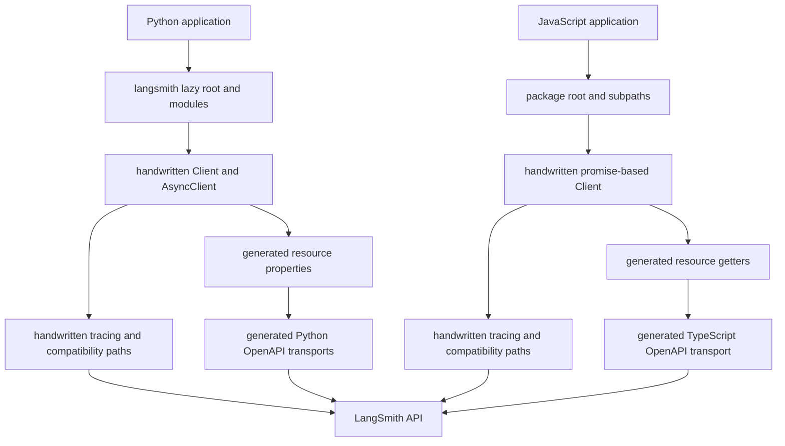

# Dual-SDK Architecture and Public Surfaces

This checkout contains two independent implementations of the LangSmith SDK:

- Python publishes the `langsmith` distribution from `python/`.
- JavaScript/TypeScript publishes the `langsmith` npm package from `js/`.

They model the same platform, but neither is a binding over a shared runtime library. Their package versions and release triggers are independent: the Python workflow watches `python/langsmith/__init__.py`, while the JavaScript workflow watches `js/package.json`. Treat capability parity as a goal that must be verified, not as proof that names, types, lifecycle, or sync behavior match.

## Layered architecture

*The public clients are composition roots: handwritten behavior and generated resource transports share resolved SDK configuration while remaining separate layers.*

The ownership boundary is absolute: **`python/langsmith/_openapi_client/` and `js/src/_openapi_client/` are generated by Stainless and must not be edited manually.** The protection workflow rejects changes to either tree unless the PR comes from the authorized `sync/langsmith-api` branch and bot. Endpoint/resource generation belongs to the upstream spec-sync process; handwritten adaptation, compatibility, orchestration, and public facades belong outside those directories.

That architectural ownership should not be confused with current contribution policy. This checkout still contains and releases both SDKs, but `CONTRIBUTING.md` says merges under `python/` and `js/` are mirrored hourly to separate staging repositories, describes those repositories as the future homes, and asks contributors to open new work there when possible. Package manifests and lockfiles are not mirrored and require manual ports. In other words, use the boundaries described here to understand the code, but do not infer that every new change should originate in this repository.

## Handwritten clients as composition roots

The handwritten clients do substantially more than serialize OpenAPI operations. They resolve endpoint, credentials, workspace, profiles, headers, timeout and retries; own tracing queues and preprocessing; enforce masking/anonymization and sampling; and retain compatibility methods. Generated v2 resources are mounted into that state rather than replacing it.

### JavaScript and TypeScript

JavaScript exposes one `Client`; network methods return promises rather than requiring a separate `AsyncClient`. Its `createRun` path demonstrates the handwritten layer:

1. Apply trace sampling and reject conflicting project/address destinations.
2. Resolve an agent address from environment when neither project nor address is present; an invalid environment address is logged and tracing is dropped rather than breaking the application.
3. Preprocess the run and, when auto-batching plus `trace_id` and `dotted_order` are present, enqueue the operation.
4. Otherwise merge runtime metadata/masking and send a direct `POST /runs` through the handwritten fetch/retry path.

The generated `OpenAPILangsmith` transport is lazy. `Client` strips a terminal `/api/v1` or `/api` from the handwritten API URL and supplies the generated constructor with API-key authentication, tenant/workspace ID, timeout, the SDK fetch implementation, portable fetch options, and default headers. Because the generated constructor captures auth and headers while handwritten requests recompute them, the bridge fingerprints the current API key and default headers and rebuilds the generated client when that snapshot changes. Required auth/workspace headers win over caller headers, while a caller user agent is allowed.

Current generated getters are:

| Getter | Generated family | Minimum backend checked on access |
| --- | --- | --- |
| `evaluators` | online evaluators | `0.16.0` |
| `runs` | runs | `0.16.0` |
| `sandboxes` | sandboxes | `0.16.0` |
| `datasets` | datasets | `0.16.0` |
| `annotationQueues` | annotation queues and items | `0.16.14` |
| `threads` | threads | `0.16.0` |
| `traces` | traces | `0.16.0` |
| `sessions` | address-to-project resolution | `0.18.0` |
| `public` | public shared runs | `0.16.0` |

Getter access starts a nonblocking server-info check once per minimum version. It returns the resource immediately; a failed info lookup is handled by the server-info path rather than preventing resource construction.

### Python

Python deliberately exposes two public client classes that are not mechanical mirrors:

- `Client` is the synchronous, tracing-oriented composition root. It owns a `requests.Session`, retry adapters, tracing queues and background workers, sampling, masking/anonymization, optional multi-endpoint writes, OpenTelemetry integration, buffering, and explicit `flush()` and `close()` behavior.
- `AsyncClient` owns an `httpx.AsyncClient`, async retry/request methods, and async prompt-cache lifecycle. `async with` starts its cache; `aclose()` stops the cache and closes the handwritten HTTP client. Its constructor is narrower than `Client` and omits the synchronous client's batching and OpenTelemetry controls.

A subtle but important boundary is that public generated properties on both classes return generated **async** resources. For example, `Client.runs` is an `AsyncRunsResource`, so a generated operation reached through synchronous `Client` still has to be awaited. Blocking migration helpers use the private `Client._get_langsmith_api_sync()` transport instead.

`Client` lazily constructs generated async and sync clients. If a caller supplied a `requests.Session`, it cannot be reused by the httpx-based generated transport. The bridge copies settings with direct equivalents—user-added headers, cookie jar, TLS verification and certificate, one selected proxy, and `trust_env`—into generated httpx wrappers. Mounted adapters, `session.auth`, hooks, adapter retry policy, and pool bounds do not transfer. `AsyncClient`, by contrast, constructs its generated `AsyncLangsmith` in `__init__` from the already resolved API key, workspace, normalized base URL, timeout, and headers.

The Python resource surface is intentionally asymmetric today:

- `Client` exposes `runs`, `evaluators`, `sandboxes`, `datasets`, `annotation_queues`, `threads`, `traces`, `sessions`, and `public`.
- `AsyncClient` exposes the same set **except `sessions`**.

`Client` checks the cached backend version synchronously on property access. `AsyncClient` cannot await in a property, so it schedules and retains one background task per minimum version while an event loop is running. Its exposed families require `0.16.0`, except `annotation_queues` at `0.16.14`. Python `Client.sessions`, like JavaScript `Client.sessions`, requires `0.18.0`.

## Addressing and session resolution

Addressing is a handwritten beta surface in both runtimes, not a generated model alias. The matching forms are:

- `AgentAddress(id, environment)` names one agent environment. IDs follow the backend DNS-label rule; environments normalize to `local`, `development`, `staging`, or `production`.
- `ExperimentAddress(id)` accepts a canonical hyphenated UUID and normalizes it to lowercase.
- `EvaluatorAddress()` names the workspace's shared evaluator project.
- `Address` is the common protocol/interface, and `ApiAddress` is the generated-session endpoint's wire-shaped input (`AGENT`, `EXPERIMENT`, or `EVALUATOR`).

All three concrete forms can be resolved to a project, but **only `AgentAddress` can receive traces**. Ingestion guards reject experiment/evaluator addresses and raw strings. `AgentAddress.from_env()` reads `LANGSMITH_AGENT_ID` and `LANGSMITH_AGENT_ENVIRONMENT`; neither variable means “no address,” while a half or invalid pair raises `EnvAddressError`. Higher-level tracing entrypoints catch that configuration error and drop/log tracing so instrumentation does not break application code; explicit ingestion may surface it.

Session resolution is the generated bridge for lookup operations. JavaScript uses `await client.sessions.resolve(address.toApiAddress())`. Python's public `Client.sessions.resolve(...)` is also async, but synchronous URL compatibility code calls the private generated sync client and passes `address.to_api_address()`. The response's `session_id` is validated and then used as the project ID. Lookup helpers accept any address kind and reject a simultaneous project plus address. This distinction explains why address classes are handwritten while `sessions` is generated: address construction and ingestion policy are SDK behavior; resolution is a backend operation.

## Public import surfaces

### Python root facade

`python/langsmith/__init__.py` is a curated lazy facade. `TYPE_CHECKING` imports provide static visibility; module `__getattr__` imports implementations only when requested; and `__all__` defines the supported root surface. It includes both clients, tracing and evaluation helpers, run trees, sync and async prompt caches, UUID helpers, runtime overrides, the secret wrapper, testing helpers, and stable constants.

The address module itself and `Address`, `AgentAddress`, `ExperimentAddress`, and `EvaluatorAddress` are lazy root exports. `ApiAddress` and `EnvAddressError` are public from `langsmith.address`, but are not root names. Generated exception classes are the deliberate exception to keeping generated symbols internal: the facade retrieves them lazily and rewrites `__module__` to `langsmith`, producing stable root-level error names. Generated clients, resource classes, and models otherwise remain implementation details reached through client properties.

Python's handwritten schemas are runtime models, not aliases of generated models. They combine Pydantic validation with `TypedDict`, protocols, enums, `UUID`, timezone-aware `datetime`, and Python attachment inputs such as `bytes` and `Path`.

### JavaScript root and package subpaths

`js/src/index.ts` is a compact package root. It currently exports `Client` and client types; selected dataset/example/session/run/feedback schema types; `RunTree`; all three address classes plus `Address`, `ApiAddress`, `Environment`, and `EnvAddressError`; fetch override, project, tracing guard, UUID, prompt-cache APIs; generated error classes; version metadata; and `LS_MESSAGE_VIEW_EXCLUDE`. Higher-level tracing and integrations are intentionally reached through subpaths rather than re-exported wholesale at the root.

The current subpaths, grouped by purpose, are:

| Purpose | Package subpaths |
| --- | --- |
| Core | `langsmith/client`, `langsmith/run_trees`, `langsmith/traceable`, `langsmith/evaluation`, `langsmith/schemas`, `langsmith/langchain`, `langsmith/anonymizer` |
| Test integration | `langsmith/jest`, `langsmith/jest/reporter`, `langsmith/vitest`, `langsmith/vitest/reporter`, `langsmith/utils/jestlike` |
| Wrappers | `langsmith/wrappers`, `langsmith/wrappers/anthropic`, `langsmith/wrappers/openai`, `langsmith/wrappers/gemini`, `langsmith/wrappers/openai_agents` |
| Singleton | `langsmith/singletons/traceable` |
| Experimental | `langsmith/experimental/otel/setup`, `langsmith/experimental/otel/exporter`, `langsmith/experimental/otel/processor`, `langsmith/experimental/vercel`, `langsmith/experimental/anthropic`, `langsmith/experimental/sandbox` |
| Sandbox | `langsmith/sandbox` |

`js/scripts/create-entrypoints.js` is the source list for those package paths. The build compiles ESM and CommonJS, then the script emits `.js`, `.cjs`, `.d.ts`, and `.d.cts` forwarding shims and rewrites `package.json` `exports` and `files`. Each export has distinct import, require, and declaration targets. The `browser` map swaps filesystem and worker-thread utilities for browser implementations. Add a subpath to the script and regenerate metadata; do not maintain wrapper files by hand.

TypeScript's handwritten schemas are structural interfaces and aliases. IDs and timestamps are string/number-shaped, and attachment data uses `Uint8Array` or `ArrayBuffer`. These types do not provide Pydantic-style runtime validation. Generated request and response types remain under `_openapi_client` and are not package subpaths.

## Safe extension rules

1. Put tracing queues, destination selection, environment/profile resolution, compatibility behavior, masking, evaluation orchestration, and runtime integrations in handwritten code.
2. Change endpoint/resource generation through the upstream OpenAPI/Stainless sync. Never patch either `_openapi_client` tree manually.
3. Mount a generated family through a handwritten accessor only after adapting base URL, auth, workspace, headers, timeout, runtime transport, and backend-version policy.
4. Make imports deliberate: update Python's lazy facade and `__all__`, or update the JavaScript root or entrypoint source list and regenerate package metadata.
5. Verify parity in both implementations. Equivalent concepts may differ in casing, model system, binary type, transport, lifecycle, or even whether a resource getter exists.
6. Test the boundary, not generated internals. A bridge test should prove concrete URL, authentication/header precedence, version-check timing, and runtime-specific lifecycle or resolution behavior.

## Focused verification

The most useful tests for this architecture are:

- `python/tests/unit_tests/test_client.py` for synchronous version checks and generated migration routing.
- `python/tests/unit_tests/test_async_client.py` for one-per-version background checks and async lifecycle/request behavior.
- `python/tests/unit_tests/test_address.py` for validation, ingestion guards, destination conflicts, and synchronous session resolution.
- `js/src/tests/client_headers.test.ts` for generated/handwritten auth, header, user-agent, and generated-client rebuilding behavior.
- `js/src/tests/client.test.ts` for generated evaluator and annotation-queue endpoint composition.
- `js/src/tests/address.test.ts` for address exports, session query parameters, and run-URL resolution.
- `pnpm build` for dual-module compilation, entrypoint generation, and declarations. JavaScript lint excludes `src/_openapi_client/**`; Python Ruff and mypy similarly exclude or suppress generated-client diagnostics, reinforcing that generated fixes belong upstream.

See [Client Configuration and Authentication](/openwiki/concepts/client-configuration-and-auth.md) for precedence and credentials, [Platform Client](/openwiki/concepts/platform-client.md) for client operations, [Trace Destinations and Addressing](/openwiki/concepts/trace-destinations-and-addressing.md) for destination semantics, [Quickstart](/openwiki/quickstart.md) for first use, and [Development and Release](/openwiki/operations/development-and-release.md) for operational workflows.
