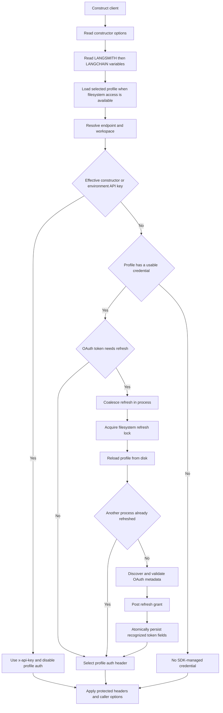

The Python `Client` and `AsyncClient`, and the JavaScript `Client`, turn constructor options, environment variables, and an optional local profile into deployment configuration for the operations described in [Platform Client](./platform-client.md). This page concerns the API deployment and its authentication and workspace context. Trace project and destination addressing—including `LANGSMITH_AGENT_*` and project/address precedence—is a separate concern covered by [Trace Destinations and Addressing](./trace-destinations-and-addressing.md).

## Configuration resolution

For the primary API endpoint and workspace, both SDKs use this precedence:

1. Constructor option: `api_url` / `apiUrl` or `workspace_id` / `workspaceId`.
2. `LANGSMITH_ENDPOINT` or `LANGSMITH_WORKSPACE_ID`.
3. Legacy `LANGCHAIN_ENDPOINT` or `LANGCHAIN_WORKSPACE_ID`.
4. The selected profile's `api_url` or `workspace_id`.
5. For the endpoint only, `https://api.smith.langchain.com`.

The environment helpers check `LANGSMITH_` before `LANGCHAIN_`. Python ignores blank environment values; JavaScript chooses the first truthy value. Stored constructor values are trimmed and have outer quotes removed. A constructor endpoint is therefore the most direct way to target a different deployment for one client. [Python resolution](repo://python/langsmith/client.py#L1283-L1306) [JavaScript resolution](repo://js/src/client.ts#L1428-L1447) [JavaScript defaults](repo://js/src/client.ts#L1558-L1594) [environment aliases](repo://js/src/utils/env.ts#L182-L201)

Authentication has a separate gate. A constructor API-key value takes precedence over an environment API key, and an effective constructor or environment key disables profile-managed authentication. The profile may still provide the endpoint and workspace. Without either key, the profile can provide `api_key` or OAuth credentials. Avoid using an empty Python constructor key to mean “unset”: Python gates profile auth on whether the argument is `None`, whereas JavaScript trims and tests the resolved key for a value. A workspace ID is not a credential: it is sent as `X-Tenant-Id` / `x-tenant-id`, and the JavaScript error mapper gives a specific remediation when a `403` reports that an organization-scoped key requires a workspace. [Python auth gate](repo://python/langsmith/client.py#L1285-L1337) [JavaScript auth gate](repo://js/src/client.ts#L1437-L1447) [JavaScript defaults](repo://js/src/client.ts#L1558-L1594) [workspace failure](repo://js/src/utils/error.ts#L154-L168)

Profile-internal credential ordering differs intentionally:

- Python profile auth prefers `api_key` over an OAuth access token.
- JavaScript profile auth prefers the OAuth access token over `api_key`.

This difference does not alter the constructor/environment gate. [Python profile headers](repo://python/langsmith/_internal/_profiles.py#L456-L467) [JavaScript profile headers](repo://js/src/utils/profiles.ts#L485-L509)

*Deployment configuration and the coordinated profile OAuth refresh decision before a request.*

## Profiles and OAuth lifecycle

Profiles are read from `LANGSMITH_CONFIG_FILE` when set, otherwise `~/.langsmith/config.json`. `LANGSMITH_PROFILE` selects a name; otherwise selection falls through to `current_profile`, then `default`. A missing file, malformed JSON, absent profile map, or unresolved profile name behaves as no profile rather than failing construction. JavaScript skips profile filesystem access in browser and web-worker runtimes. [Python profile loading](repo://python/langsmith/_internal/_profiles.py#L71-L129) [JavaScript profile loading](repo://js/src/utils/profiles.ts#L52-L107)

A profile can contain `api_key`, `api_url`, `workspace_id`, and an `oauth` object with `access_token`, `refresh_token`, and `expires_at`. OAuth refresh requires a refresh token and is attempted when the access token is absent or expires within one minute. Missing or malformed expiry data does not force refresh. In Python, a profile `api_key` also suppresses OAuth refresh because it is the preferred profile credential. Refresh is best effort: discovery, transport, lock, response parsing, and persistence failures leave the available profile state in use instead of making client construction fail. [Python refresh predicate](repo://python/langsmith/_internal/_profiles.py#L238-L264) [Python refresh path](repo://python/langsmith/_internal/_profiles.py#L388-L454) [JavaScript refresh predicate](repo://js/src/utils/profiles.ts#L117-L133) [JavaScript refresh path](repo://js/src/utils/profiles.ts#L378-L475)

Refresh is coordinated at two levels. Python uses a process-local lock and JavaScript a shared promise; both also serialize processes that share the config file with a filesystem lock. After taking that lock, the refresher reloads the profile and skips the network when another process has already stored a fresh token. Python uses `flock` on POSIX and an atomic directory lock elsewhere; JavaScript uses the directory-lock form. Directory locks recover stale owners and release only when ownership still matches. Successful refresh applies only recognized token fields and atomically replaces the profile file; Python uses owner-restricted modes. [Python refresh lock](repo://python/langsmith/_internal/_oauth_refresh_lock.py#L95-L160) [JavaScript refresh lock](repo://js/src/utils/profile-lock.ts#L64-L118) [Python persistence](repo://python/langsmith/_internal/_profiles.py#L297-L324) [JavaScript persistence](repo://js/src/utils/profiles.ts#L418-L475)

### OAuth discovery is a security boundary

Discovery probes the configured issuer, self-hosted `/api`, and root locations, including the RFC 8414 path-inserted well-known form. Metadata is accepted only when `issuer` equals the probed base after trailing-slash normalization and both advertised device and token endpoints have the issuer's scheme and host. Issuer mismatches, off-origin endpoints, invalid JSON, HTML SPA responses, and failed requests are ignored so they cannot redirect a refresh token to an untrusted host. [Python discovery](repo://python/langsmith/_internal/_profiles.py#L132-L235) [JavaScript discovery](repo://js/src/utils/profiles.ts#L135-L282) [focused Python tests](repo://python/tests/unit_tests/test_profiles_oauth_discovery.py#L91-L160) [focused JavaScript tests](repo://js/src/tests/profile-oauth-discovery.test.ts#L98-L179)

If no trusted document is found, refresh falls back to `<normalized-profile-api-url>/oauth/token`. Normalization removes `/api/v1` but retains `/api`, because a self-hosted authorization server may be mounted there. Refresh uses the profile's `api_url`, not a constructor endpoint override, keeping the refresh token associated with the deployment that issued the profile. [fallback behavior](repo://python/langsmith/_internal/_profiles.py#L221-L235) [JavaScript refresh endpoint](repo://js/src/utils/profiles.ts#L418-L450)

## Endpoint composition and self-hosting

A configured API URL may be a bare origin or already end in `/api` or `/api/v1`. Before generated clients append their generated `/api/v2/...` routes, both SDKs strip a trailing `/api` or `/api/v1`; a bare `/v1` is deliberately retained. [JavaScript normalizer](repo://js/src/utils/api_url.ts#L1-L7) [Python normalizer](repo://python/langsmith/client.py#L175-L181) [Python normalization tests](repo://python/tests/unit_tests/test_client.py#L6005-L6060)

Handwritten platform operations must instead use `_getPlatformEndpointPath` in JavaScript or `_platform_path` in Python. These helpers omit a second `/v1` when the configured base already ends in `/v1`. [JavaScript helper](repo://js/src/client.ts#L1806-L1811) [Python helper](repo://python/langsmith/client.py#L11934-L11939)

> **Self-hosted URL invariant:** never hardcode a leading `/v1` for a platform operation. Use the platform path helper or a generated resource route. Otherwise `https://host/api/v1` can become the invalid `/api/v1/v1/platform/...`.

The clients remove a trailing slash from the effective API URL. `web_url` / `webUrl` is independent; when omitted, host inference handles localhost, known hosted regions, and common API suffixes. Set it explicitly when a self-hosted API and UI do not follow those conventions. [JavaScript URL handling](repo://js/src/client.ts#L1431-L1444) [JavaScript host inference](repo://js/src/client.ts#L1597-L1630)

## Headers, caller authentication, and generated clients

Client-wide custom headers are merged beneath SDK-owned authentication and workspace headers, so they cannot replace a configured API key or tenant ID. JavaScript accepts both `headers` and `fetchOptions.headers`; it resolves names case-insensitively, and `fetchOptions.headers` wins collisions. Malformed JavaScript header names fail during construction or assignment. [JavaScript merge](repo://js/src/client.ts#L1508-L1517) [JavaScript effective headers](repo://js/src/client.ts#L1633-L1691) [header tests](repo://js/src/tests/client_headers.test.ts#L34-L108) [Python merge](repo://python/langsmith/client.py#L1856-L1872)

Per-request authentication is more permissive when the client has no explicit/environment key. Python merges `request_kwargs.headers` and direct `headers` over client defaults, then removes stale profile-managed values while preserving a genuinely explicit `Authorization` or `x-api-key`. JavaScript similarly avoids refreshing over an explicit request credential. If JavaScript has a configured client API key, that key remains SDK-owned: it removes `Authorization` and ensures `x-api-key` is present. This supports delegated per-request credentials only when client-level key authentication was not selected. [Python request merge](repo://python/langsmith/client.py#L2018-L2032) [Python profile cleanup](repo://python/langsmith/_internal/_profiles.py#L368-L381) [JavaScript request auth](repo://js/src/client.ts#L1168-L1291)

JavaScript's generated client captures API key and default headers. The wrapper computes a signature each time the generated resource is accessed and rebuilds the generated client when effective custom headers or current profile authentication change, including mutation through the `headers` getter. It also passes the normalized base URL, workspace, timeout, wrapped fetch, and `fetchOptions` except request-specific `method`, `body`, and `signal`. [generated-client options](repo://js/src/client.ts#L1694-L1741) [rebuild lifecycle](repo://js/src/client.ts#L1758-L1803) [rebuild tests](repo://js/src/tests/client_headers.test.ts#L168-L230)

Python has a different lifecycle. `Client` lazily creates and caches its generated sync and async clients, while `AsyncClient` creates its generated client during construction; they are not rebuilt by the custom-header setters. Configure endpoint, credentials, workspace, and headers before first generated-resource access. For a caller-supplied `requests.Session`, handwritten calls use the session directly, while generated calls translate user-added headers, scoped cookies, TLS verification and client certificate, environment trust, and one proxy into an `httpx` client. Mounted adapters, `session.auth`, hooks, pool bounds, and session retry behavior do not cross that transport boundary. [Python generated clients](repo://python/langsmith/client.py#L1606-L1664) [session translation](repo://python/langsmith/client.py#L184-L232) [transport tests](repo://python/tests/unit_tests/test_client.py#L6112-L6200) [Python async construction](repo://python/langsmith/async_client.py#L273-L331)

## Retries, timeouts, and failures

JavaScript handwritten operations use `AsyncCaller`. It retries status `408`, `425`, `429`, `500`, `502`, `503`, and `504` with randomized exponential backoff, rejects ordinary non-retryable statuses, and does not retry cancellation or timeout/abort failures. The ordinary caller always sets four retries because its `maxRetries` is applied after `callerOptions`; the trace-ingest caller applies `callerOptions` after its four-retry default, so ingestion can override it. The ingestion caller also owns the rate-limit hook and queue concurrency/byte limits. [caller setup](repo://js/src/client.ts#L1448-L1490) [retry policy](repo://js/src/utils/async_caller.ts#L5-L13) [retry control](repo://js/src/utils/async_caller.ts#L119-L206) [focused tests](repo://js/src/tests/client_retry.test.ts#L76-L160)

Python's synchronous `Client` mounts an urllib3 policy with three retries, the same status force-list, `Retry-After` support, and all methods on supported urllib3 versions. Handwritten operations can additionally set `stop_after_attempt` and retry exception classes. `AsyncClient` defaults to three attempts and retries connection, timeout, and server API errors, while call sites can add exception types. [sync policy](repo://python/langsmith/client.py#L671-L700) [sync request entrypoint](repo://python/langsmith/client.py#L1979-L2032) [async retry control](repo://python/langsmith/async_client.py#L456-L504)

Timeout configuration is transport-specific: Python sync accepts one millisecond value or connect/read values; Python async accepts one value or the `httpx` timeout tuple; JavaScript `timeout_ms` defaults to 90 seconds. A `401` indicates authentication failure, and the organization-scoped-key `403` calls for a workspace. Do not treat `400`, `404`, or conflict responses as generic availability failures.

## Runtime and operational constraints

- Browser and web-worker JavaScript clients cannot discover local profiles. Pass `apiUrl`, credentials or a narrow explicit header, workspace, and any `fetchImplementation` explicitly. Environment access is guarded because `process` may be absent and some Deno configurations throw on reads. [runtime detection](repo://js/src/utils/env.ts#L5-L50) [guarded reads](repo://js/src/utils/env.ts#L182-L201)
- Browser bundles replace filesystem support with safe stubs, so on-disk profile refresh and persistence are server-runtime features. Do not embed long-lived API keys or refresh tokens in browser-delivered code. [profile runtime gate](repo://js/src/utils/profiles.ts#L52-L107)
- Keep workspace selection with deployment authentication. Do not use workspace headers to model trace destination or project selection; use the addressing mechanisms documented in [Trace Destinations and Addressing](./trace-destinations-and-addressing.md).
- When debugging configuration, first log the resolved API URL source, then inspect the effective workspace and credential channel, and only then investigate retry behavior. This avoids mistaking a wrong deployment or workspace for a transient transport failure.
