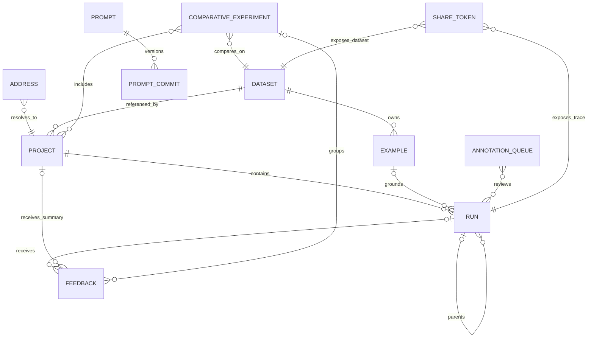
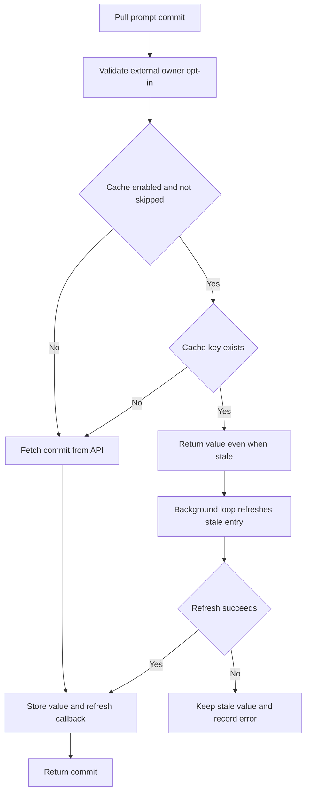

The Python `Client` and `AsyncClient` and the JavaScript `Client` are façades over a connected resource graph, not independent bags of CRUD methods. A safe change starts by identifying which resource owns the state, which IDs are foreign keys or partition keys, and whether the operation belongs to a handwritten compatibility/composition surface or a generated resource.

Configuration, authentication, endpoint normalization, retries, and headers are covered in [Client Configuration, Endpoints, and Authentication](./client-configuration-and-auth.md). Trace destination precedence is covered in [Trace Destinations and Addressing](./trace-destinations-and-addressing.md), and evaluation orchestration in [Evaluation and Experiments](../workflows/evaluation-and-experiments.md).

## Resource map

*The platform resource graph: UUID relationships own durable state, while an address resolves to the project UUID needed by project-scoped query and UI operations.*

The important ownership boundaries are:

| Domain | Owner and identifiers | What the client resolves or preserves |
| --- | --- | --- |
| Projects, addresses, and runs | A project is the API's `session`; `Run.session_id` is its project ID. Runs form traces through `trace_id`, `parent_run_id`, and `dotted_order`. An address names the project holding an agent environment, experiment, or evaluator traces. | Project names are edge conveniences. The beta generated `sessions.resolve` operation converts an address query into `session_id`; only `AgentAddress` is a valid trace-ingestion destination, while all three address kinds are query-resolution inputs. |
| Datasets and examples | Every `Example` has a `dataset_id`; an example may record `source_run_id`. A run may point back through `reference_example_id`. | Dataset names are resolved before dataset-scoped multipart writes. Updates lacking `dataset_id` read the example to recover its owner, so a batch must not silently mix datasets. |
| Feedback | Feedback has its own ID and targets either a run (`run_id`, with `trace_id` as trace context) or a project (`session_id`) for summary feedback. It may carry comparative experiment/group IDs and evaluator source-run provenance. | Creation validates the exclusive run/project target. Run feedback should carry the owning `session_id`; a SmithDB-only deployment rejects it before transport when that partition key and an address are both absent. `start_time` remains optional. |
| Experiments | An experiment is represented by a project whose `reference_dataset_id` identifies the evaluated dataset. A comparative experiment contains project IDs and one reference dataset ID. | If a comparative call omits the dataset ID, the handwritten client derives it from the first experiment project. Comparison feedback uses the comparative experiment ID, not a project ID. |
| Annotation queues | A queue owns review membership and rubric metadata; its members are runs. | Modern membership uses a `RunKey` containing `run_id`, `session_id`, and `start_time`, with optional `source_proposed_example_id`. These partition fields avoid a bare-ID scan; legacy insertion remains a compatibility route. |
| Prompts and Hub | A prompt repository is `owner/name`; a commit adds `:hash` or `:tag`, and `latest` is the default. An unqualified name uses owner `-` for the current tenant. | Metadata belongs to the repository; serialized prompt content belongs to commits. Push composes repository create/patch, commit creation, and optional tags, while owner checks prevent cross-tenant mutation. |
| Sharing | Run sharing associates a token with a trace; dataset sharing associates one with an existing dataset. | Generated `runs.share` is the current run surface and child runs share their trace root. Dataset sharing remains handwritten. Deletion removes the association, not the underlying run or dataset. Presigned feedback tokens are narrower capabilities bound to a run and feedback key. |
| Threads | A thread groups runs within a project by `thread_id`; it is not independently created by the handwritten client. | Thread reads require project context. Current query, statistics, and trace-list operations belong to the generated `threads` resource. |

These links are represented directly by the schemas and generated request types: projects are sessions; runs carry project, trace, parent, and example keys; examples carry dataset/source-run keys; and run share deletion takes the trace plus project partition identifier. [run and project keys](repo://python/langsmith/schemas.py#L394-L460) [example ownership](repo://python/langsmith/schemas.py#L82-L149) [generated run sharing](repo://js/src/_openapi_client/resources/runs/share.ts#L10-L70)

## Handwritten façade versus generated resources

The SDKs are in a migration period. Handwritten methods still own compatibility signatures and cross-resource composition for projects, examples, feedback, prompt manifests, dataset sharing, pagination adapters, URL construction, and deprecated routes. Generated Stainless resources own schema-shaped operations already represented by OpenAPI.

The current façade getters and backend compatibility checks are:

| Getter | Generated domain | Minimum backend version checked |
| --- | --- | --- |
| `evaluators`, `runs`, `sandboxes`, `datasets`, `threads`, `traces`, `public` | Online evaluators, run/trace queries and sharing, sandboxes, datasets v2, threads, and public shared runs | `0.16.0` |
| `annotationQueues` / `annotation_queues` | Queue runs and items | `0.16.14` because item endpoints landed later |
| `sessions` | Beta address-to-project resolution at `/api/v1/sessions/resolutions` | `0.18.0` |

JavaScript returns generated resources synchronously and starts an asynchronous `/info` compatibility check; failures are logged or swallowed by the information lookup, so the generated request remains the ultimate capability test. Python `Client` exposes **async** generated resource properties, alongside its synchronous handwritten methods; internal synchronous composition can use the generated sync client directly. Python checks the known `info.version` and warns for old or unparseable versions rather than making the getter a hard feature gate. [JavaScript getters](repo://js/src/client.ts#L1813-L1867) [JavaScript check behavior](repo://js/src/client.ts#L2457-L2484) [Python getters](repo://python/langsmith/client.py#L1609-L1719) [Python check behavior](repo://python/langsmith/_internal/_backend_version.py#L8-L24)

When extending the SDK:

- Put schema-shaped operations already represented in OpenAPI into the generated resource and expose that resource through the façade; do not add a second handwritten transport merely for naming symmetry.
- Keep handwritten code where it composes several resources, resolves names, normalizes a legacy signature, deserializes manifests, constructs an application URL, or implements compatibility behavior outside the wire schema.
- Follow deprecation pointers. For example, current run sharing is `client.runs.share.create/delete`, while `shareRun` / `share_run` and their unshare counterparts remain deprecated handwritten adapters until their announced removal.
- Preserve generated-client configuration parity. Base URL, API key, tenant/workspace ID, timeout, caller headers, and transport customization must behave consistently across handwritten and generated requests.

## Address and session resolution

`AgentAddress`, `ExperimentAddress`, and `EvaluatorAddress` are typed handles, not project records. They serialize for resolution as `AGENT` plus ID and environment, `EXPERIMENT` plus UUID, or `EVALUATOR` alone. Agent environments are normalized locally and sent uppercase. The generated sessions resource sends these as query parameters and returns one `session_id`; callers then use that UUID wherever an endpoint expects a project/session ID. A missing or unreadable address returns 404, while BYOC data planes currently return 501. [address contracts](repo://python/langsmith/address.py#L1-L14) [generated resolution contract](repo://python/langsmith/_openapi_client/resources/sessions.py#L45-L102) [JavaScript route](repo://js/src/_openapi_client/resources/sessions.ts#L8-L22)

Only an `AgentAddress` can receive traces. Experiment and evaluator addresses exist so query/UI operations can find those features' projects, not as ingestion destinations. Handwritten run URL composition is a representative composition path: it first prefers the run's `session_id`, then explicit project/address context, resolves an address once through `sessions.resolve`, and embeds the resulting project UUID in the UI URL. [JavaScript URL resolution](repo://js/src/client.ts#L3283-L3358) [Python sync composition](repo://python/langsmith/client.py#L4928-L4975) [focused sessions test](repo://js/src/tests/address.test.ts#L819-L860)

Resolution is distinct from wire ingestion. Agent-directed trace payloads carry the agent LRN internally, whereas `sessions.resolve` accepts the public API-address object. Do not expose or accept the internal LRN as a general user identifier, and do not resolve an address merely to post a trace.

## Name resolution and partition invariants

Most handwritten methods accepting `id` or `name` require exactly one. They resolve a name once and perform the resource operation by UUID. Projects use `/sessions`; datasets use `/datasets`. Missing names become not-found failures, malformed UUIDs fail locally where validation exists, and ambiguous ID-plus-name inputs fail before transport.

Runs preserve three notions that must not be substituted:

- `session_id`: project ownership and the principal storage partition;
- `trace_id`: all spans in one nested execution;
- `thread_id`: application-level grouping across traces.

Child hydration queries by project and trace, orders by `dotted_order`, and rebuilds `child_runs` from `parent_run_id`; a returned child without a parent is invalid data. Annotation queue membership similarly uses the full run partition key. [child hydration](repo://js/src/client.ts#L3361-L3402) [RunKey rationale](repo://python/langsmith/schemas.py#L895-L904)

### Backend-aware feedback

Run-level feedback needs both the target run and enough context to locate it. The modern call supplies `session_id` / `sessionId`; an agent address can satisfy the same location requirement because it names the project directly. If neither is present, both SDKs inspect backend query flags: SmithDB-only (`sdb_query_enabled` without ClickHouse query support) raises before posting, while other deployments emit a deprecation warning and preserve legacy lookup behavior. Project-level summary feedback already has `project_id`, so it does not need a run partition lookup. `start_time` improves location/performance where accepted but is not required for feedback creation. [JavaScript validation](repo://js/src/client.ts#L2494-L2518) [JavaScript feedback mapping](repo://js/src/client.ts#L5579-L5682) [Python validation](repo://python/langsmith/client.py#L780-L796) [Python feedback mapping](repo://python/langsmith/client.py#L8474-L8558) [focused SmithDB tests](repo://python/tests/unit_tests/test_client.py#L2260-L2285)

Feedback creation also preserves provenance: `trace_id`, `comparative_experiment_id`, comparative group ID where supported, and evaluator `source_run_id` metadata are relationships, not interchangeable targets. Supplying neither a run/trace nor project, or supplying both run and project targets, is rejected before transport.

## Iteration and pagination

List calls are lazy: Python yields iterators or async iterators, and JavaScript returns `AsyncIterable`s. Callers should consume only what they need rather than materializing an unbounded collection.

Two handwritten transport patterns recur:

1. **Offset pagination** for datasets, examples, projects, feedback, prompts, commits, and queues. The shared helper defaults to pages of 100, advances by the number returned, and stops on an empty or short page. A public `limit` may independently cap total yielded records.
2. **Cursor pagination** for legacy run queries and shared runs. The request body receives `cursors.next`; iteration stops when the data key, cursor block, or next cursor is absent.

Do not assume every `limit` is a page size. Some methods clamp each request to 100 while tracking a separate total; generated resources may expose their own page objects and cursor contracts. Preserve the method's response envelope and stopping rule when adding filters. [JavaScript helpers](repo://js/src/client.ts#L1910-L2010) [Python helpers](repo://python/langsmith/client.py#L2185-L2256)

## Prompt repositories, commits, trust, and secrets

`parseHubIdentifier` defines the shared grammar: `name` becomes `-/name:latest`; `owner/name:version` preserves all three components, and malformed slash/colon layouts fail locally. Pull returns a prompt commit containing owner, repository, commit hash, manifest, examples, and optional model configuration. The cache key includes the exact caller identifier and adds `:with_model` when model data was requested, preventing model-bearing and prompt-only responses from colliding. [identifier parsing](repo://js/src/utils/prompts.ts#L3-L35)

**Pulled manifests are executable configuration, not trusted text.** Both clients reject an explicit external-owner pull before network or cache access unless the caller opts in with `dangerously_pull_public_prompt` / `dangerouslyPullPublicPrompt`. Trust reviewed content rather than only its publisher, pin a commit instead of mutable `latest`, and avoid `include_model` for external prompts because model configuration can affect endpoints, headers, model names, and constructors.

Python adds a secret-resolution boundary during LangChain deserialization. Explicit serialized secret references use only the supplied `secrets` map by default; environment lookup requires `secrets_from_env=True`. A secret marker with neither source raises an explanatory error. This does **not** sandbox a deserialized integration from independently using its normal environment credential defaults. Where supported, loading limits allowed objects to `core` unless `include_model=True`. [Python safeguards](repo://python/langsmith/client.py#L476-L550)

## Prompt cache lifecycle

*Prompt pulls use stale-while-revalidate caching, but the external-owner trust gate runs before cache lookup.*

Caching is enabled by default and uses a process-global cache unless disabled for a client; the legacy custom `cache` option remains for compatibility. Entries are LRU-evicted at the configured maximum. Reads update recency and the refresh callback, stale entries are served immediately, and a background thread (Python) or unref'ed timer (JavaScript) refreshes them. Refresh failure retains stale data and records failure metrics. A zero maximum disables storage; infinite TTL supports static/offline use. [Python cache core](repo://python/langsmith/prompt_cache.py#L117-L195) [cache behavior tests](repo://python/tests/unit_tests/test_prompt_cache.py#L150-L220)

Caches can be dumped to JSON and loaded for offline use. Writes use a temporary file and rename; missing or malformed files load zero entries; loaded entries receive a fresh TTL and no refresh callback until accessed by a client. Cache files contain complete prompt manifests and optional model configuration, so protect and review them as executable configuration and never treat persistence as a secret store. JavaScript browser builds replace filesystem operations with no-ops. [Python persistence](repo://python/langsmith/prompt_cache.py#L197-L292) [JavaScript persistence](repo://js/src/utils/prompt_cache/index.ts#L238-L302)

## Sharing and capability boundaries

Run and dataset sharing expose existing resources; they do not clone them. The current generated run API creates or returns a token for the trace and documents that sharing a child run shares its trace root. Deletion is idempotent and identifies the trace with `trace_id` plus optional `session_id`. The old handwritten run-share methods remain deprecated adapters. Dataset share/unshare is still handwritten, can resolve a dataset name to its ID, and reads the shared dataset and examples through `/public/...` routes. [generated run sharing](repo://python/langsmith/_openapi_client/resources/runs/share.py#L43-L131) [handwritten compatibility](repo://python/langsmith/client.py#L4977-L5041) [dataset sharing](repo://python/langsmith/client.py#L5197-L5276)

Presigned feedback tokens are deliberately separate from broad share links and API keys. They bind authorization to one run and feedback key, optionally include feedback configuration/ID, and default to three hours. They let a browser submit feedback without receiving the workspace credential. Treat both share tokens and presigned URLs as bearer capabilities: avoid logging them, scope them narrowly, and revoke or expire them when no longer needed. [JavaScript feedback token](repo://js/src/client.ts#L5786-L5840) [Python feedback token](repo://python/langsmith/client.py#L8785-L8848)

## Focused change checklist

When changing a platform operation:

1. Identify the owning resource and preserve foreign and partition keys through request mapping and response normalization.
2. Resolve display names or addresses only where composition needs a UUID; do not conflate address wire ingestion with project resolution.
3. Choose generated OpenAPI resource or handwritten composition deliberately, and update the façade's backend compatibility check when a generated capability has a newer minimum.
4. Preserve pagination envelope, page size, total-limit behavior, and cursor/offset stopping rules.
5. For run feedback and run-oriented storage, test SmithDB-only behavior with `session_id` and any other documented partition key.
6. Keep public prompt trust validation before network and cache access, `include_model` in cache identity, and Python secret environment lookup opt-in.
7. Test no-request validation failures, exact route/body/query serialization, more than one pagination page, share revocation, and cross-resource IDs. For prompt caching, cover LRU eviction, stale refresh success/failure, persistence, disabling, and global-cache sharing.
