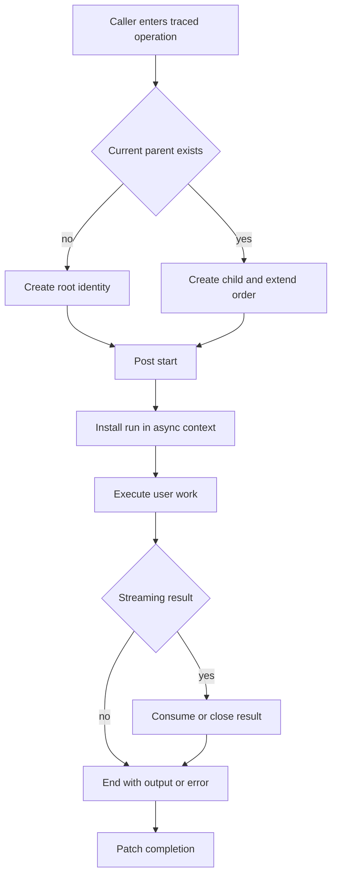

# Run Trees, Trace Identity, and Context Propagation

A **run** is the SDK's span-like record for one operation: a chain, model call, tool call, retriever, or another named unit of work. A root run represents a trace; descendants represent nested work. `RunTree` is the mutable client-side form used while capturing that work. It owns the run payload, structural and trace identity, ordering, completion fields, and routing instructions needed to post the start and patch the result.

The JavaScript and Python implementations share the wire model, but differ in their in-memory links, runtime context, and stream wrappers. Manual producers should preserve the wire invariants below rather than copying incidental wrapper behavior from one language.

## The run tree and its identities

The identity fields have distinct jobs:

- `id` identifies exactly one run. When absent, both SDKs generate a UUID v7 from the run start time. Time-derived UUIDs improve temporal locality but do not replace `dotted_order`.
- `parent_run_id` is the direct structural edge to the parent. JavaScript also retains `parent_run`; Python consumes a supplied `parent_run` to derive `parent_run_id` and `parent_dotted_order` but no longer retains that back-reference. Both keep `child_runs` as a construction convenience.
- `trace_id` identifies the whole trace. A root defaults it to its own `id`; a child inherits the root value from its parent.
- `dotted_order` is the complete ancestry and ordering key. Each segment combines a sortable timestamp prefix with that segment's run UUID, and a child appends its segment to its parent's value with `.`.
- `start_time`, `end_time`, `inputs`, `outputs`, `error`, `events`, `extra.metadata`, `tags`, and `attachments` carry the run's lifecycle and observations rather than its identity.

For a tree `R -> C -> G`, the wire relation is:

```text
R.trace_id == R.id
C.trace_id == R.id
G.trace_id == R.id
C.parent_run_id == R.id
G.parent_run_id == C.id
G.dotted_order == R.segment + "." + C.segment + "." + G.segment
```

JavaScript adds an execution-order tie breaker to its millisecond clock when forming a segment and propagates the largest child execution order upward. Python has microsecond `datetime` values and clamps an explicitly supplied child `start_time` to the parent time if it is earlier. Both protect the rule that ancestry and timestamp ordering must not contradict each other.

### Batch-ingest invariants

`trace_id` and `dotted_order` are not optional conveniences on batch paths. JavaScript multipart ingestion rejects creates and updates that omit either field. Python only admits a create to its tracing queue/compressed batch route when both are present; otherwise it falls back to the non-batched request path. Sampling also uses trace identity—first `trace_id`, then the root segment of `dotted_order`, then `id`—so all runs in a trace receive one sampling decision.

For safe producers and transformations:

1. Set root `trace_id` to the root `id`.
2. Preserve that exact `trace_id` on descendants unless intentionally rerooting one replica.
3. Append one timestamp-plus-UUID segment per parent-child edge; never regenerate only the leaf segment.
4. Ensure each segment's UUID suffix matches the corresponding run identity, including after replica remapping.
5. Include `trace_id` and `dotted_order` on start and completion operations. A patch can race or merge with its create in a batching queue.
6. When inputs are excluded from a patch, omit the key rather than sending `inputs: undefined` or `None`; merging an update containing the key can overwrite create inputs. Both SDKs default `LANGSMITH_EXCLUDE_INPUTS_ON_PATCH` to enabled, so inputs first added after posting require `excludeInputs: false` or `exclude_inputs=False`.

## Construction and destination inheritance

`createChild` / `create_child` is the direct construction boundary. It sets the parent identity, inherits the already-selected project or address and client, generates or accepts the child's identity, extends `dotted_order`, and adds the child to the parent's `child_runs`. Parent metadata is copied and explicit child keys win. Direct construction does **not** universally imply tag inheritance: tracing wrappers assemble inherited tags before calling it.

Destination inheritance is deliberately tree-shaped: after a parent has selected either project addressing or agent addressing, direct children copy that choice rather than independently consulting environment defaults. Full call-site, context, project, address, and environment precedence belongs on [Trace Destinations and Addressing](trace-destinations-and-addressing.md).

Most application code instead uses `traceable` or Python's `trace` context manager. A wrapper discovers the current parent, creates a child or root, posts the start, installs the new run as current context while user code executes, and later ends and patches it. If the result is an iterator or stream, completion is deferred until that result is consumed, closed, cancelled, or fails.



*Tracing context creates the tree immediately, while the result shape decides when completion can be persisted.*

### JavaScript runtime context

JavaScript runs the operation through `AsyncLocalStorage`. Its store contains the current `RunTree` or a tracing-disabled placeholder, so promises, timers, and nested traced calls can recover the parent. It captures a snapshot for async iterators and `ReadableStream` reads so each continuation executes under the same LangSmith and OpenTelemetry context. `withRunTree` and an explicit first `RunTree` argument are escape hatches when async-local storage is unavailable or unreliable.

The run also carries symbol-keyed LangChain context variables. `createChild` transfers this state and updates copied LangChain callback state so LangChain and `traceable` nesting stay in one tree. Child-completion promises let successful parents wait for nested runs before final output handling; error and cancelled iterator paths deliberately skip that wait to avoid hanging behind unfinished children.

### Python runtime context

Python uses `contextvars` for the active parent, destination, tags, metadata, tracing mode, client, replicas, and distributed parent ID. The active parent is stored as a **weak reference**, preventing contexts captured by `asyncio.create_task`, `call_later`, and similar APIs from retaining completed trees indefinitely.

`_setup_run` takes a copied context and installs the new run there. On Python versions supporting an explicit task context, async wrappers create a task with that context; older runtimes temporarily restore tracing context around awaits. Generator iteration similarly runs each `next` or `anext` in the captured context, because generator bodies execute during iteration rather than construction.

`tracing_context` is the scoped configuration entrypoint. It accepts a `RunTree`, request headers, a dotted-order string, or an ignored parent, merges parent tags and metadata with block-local values, and restores prior context on exit. `configure` supplies process-wide fallbacks, while context-local values take precedence during run setup.

## Metadata, tags, and distributed handoff

Metadata lives under `extra.metadata`. Direct child construction merges parent metadata first and explicit child metadata second. Wrapper configuration combines invocation, active-context, and decorator metadata; wrappers also accumulate tags, with language-specific ordering and deduplication. Metadata and tags are inherited annotations, not identity.

Across a service boundary, `toHeaders` / `to_headers` exports:

- `langsmith-trace`: the full current `dotted_order`;
- `baggage`: URL-encoded metadata, tags, and the selected project or address when present.

`fromHeaders` / `from_headers` reconstructs a placeholder for the upstream run. The first dotted segment supplies `trace_id`, the last supplies `id`, and Python also recovers the immediate `parent_run_id` when one exists. The placeholder is not responsible for completing the upstream run; creating a child from it extends the same trace in the receiving process. Missing `langsmith-trace` produces no parent.

Both parsers retain compatibility for a `langsmith-replicas` baggage item, but current `toHeaders` / `to_headers` serializers do not emit that item. An integration that deliberately forwards replica routing must therefore supply it itself and treat it as untrusted input; normal SDK handoff forwards trace identity and annotations, not credentials or client objects.

On import, replica objects are restricted to routing fields, and credentials and dedicated `client` objects are discarded. JavaScript currently permits the retained `updates` object as a whole. Python additionally filters keys inside `updates` through a fail-closed allow-list: the default is `reroot`, `metadata`, and `tags`; `LANGSMITH_BAGGAGE_ALLOWED_UPDATE_FIELDS` replaces the configurable portion, while `reroot` is always retained. Malformed baggage is ignored or rejected as a parent rather than allowed to break request handling.

## Lifecycle and completion semantics

A normal run has two persistence phases:

1. `postRun()` / `post()` sends the start payload, normally without recursively embedded children.
2. `end()` records completion in memory; `patchRun()` / `patch()` sends the completion payload.

Python `patch()` calls `end()` when needed. JavaScript `end()` is idempotent for outputs, error, and end time—the first non-null value wins—so a later cancellation marker does not overwrite an earlier stream error. Posting and patching clear or avoid recursive children on the normal independent-run path.

Exactly-once completion is primarily a wrapper control-flow property, not a server transaction. Each ordinary success/error branch schedules one end-and-patch sequence. Python returned-stream wrappers add a `__ls_completed__` guard, so exhaustion, context exit, and destructor cleanup cannot finalize the same wrapper repeatedly. Callers should still consume or explicitly close streaming results; merely obtaining one is not completion.

### Functions, generators, iterators, and streams

| Path | Successful completion | Error, early close, or cancellation |
|---|---|---|
| JavaScript value or promise | Outputs are processed, child completion may be awaited, then the run is ended and patched. | Sync throws become rejected promises. Rejection is recorded as `String(error)`, completion is patched, and the original error is rethrown. The parent fails fast without waiting for unfinished children. |
| JavaScript async iterator | Yielded chunks are accumulated; exhaustion aggregates them and completes the run. LLM runs add `new_token` events. | Iterator errors are recorded and rethrown. Early consumer termination calls the source iterator's `return()`, records `Cancelled`, preserves partial outputs, and skips waiting for children. |
| JavaScript `ReadableStream` | Reads run under captured context; source exhaustion completes with aggregated chunks. | A source read error records the original error and partial chunks, then rethrows. `cancel(reason)` records `Cancelled` with chunks seen so far before forwarding cancellation to the source reader. |
| JavaScript sync generator | The implementation eagerly drains a recognized generator in the promise-completion path, aggregates its full output, and resolves to a replaying generator. | Consumer-side early termination cannot cancel an already-drained producer. A producer throw during eager `gatherAll` rejects the completion promise before `handleRunOutputs` runs, so this path does not currently guarantee a completion patch. |
| Python sync or async function | Return output is normalized, then `end()` and `patch()` run. | Wrappers catch `BaseException`, finalize, and re-raise. Async cleanup is shielded so task cancellation cannot cancel trace finalization. `exceptions_to_handle` suppresses recorded error text but does not suppress the exception. |
| Python generator or async generator | Chunks are accumulated during iteration and optionally reduced; exhaustion finalizes the run. Every iteration executes in captured context. | `BaseException`, including close and cancellation signals, finalizes with partial chunks and is re-raised; async finalization is shielded. |
| Python returned stream wrapper | `_TracedStream` / `_TracedAsyncStream` remains open until exhaustion or context-manager exit, then finalizes accumulated chunks. Destruction performs best-effort finalization, and the completion flag prevents repeats. | Sync iteration passes the exception to trace finalization. The async stream wrapper finalizes on iteration exception or `__aexit__`, but its `__aiter__` and `__aexit__` paths currently do not pass that exception into `_aend_trace`; do not assume every async-stream cancellation is labelled as an error. |

The practical rule is to consume or explicitly close streams. JavaScript async iterators and readable streams have an explicit `Cancelled` result on early close; Python generator close is represented by formatted caught exception state rather than one standardized cancellation string.

## Attachments

Attachments are named binary sidecars, separate from JSON inputs and outputs. JavaScript accepts a MIME type plus `Uint8Array`/`ArrayBuffer` in tuple or description form. Python accepts `Attachment(mime_type, data)` and tuple forms; an argument annotated as `Attachment` is extracted from inputs automatically. `RunTree._get_dicts_safe` also moves `Attachment` values found in Python inputs into the attachment map before upload.

Python attachment data may name a filesystem path, but reading it is disabled unless `dangerously_allow_filesystem=True`. Without that opt-in, the client accepts inline bytes or the supported content-type-and-bytes form and raises on path-like or ambiguous values. This is a security boundary, not merely a serialization preference.

On multipart ingest, attachment parts are keyed to the run operation while JSON inputs omit the binary value. Python records an `uploaded_attachment` event after posting and filters already-uploaded tuple attachments from the patch to avoid duplicate upload.

## Replica identity rewriting and rerooting

A run can carry write replicas that choose a destination URL/client, project or address, authentication, whether IDs stay primary, payload updates, and reroot behavior. Children inherit replica configuration. JavaScript strips the top-level `reroot` flag when inheriting replicas, so it applies only on the run where explicitly configured; Python's reroot control is carried in replica `updates` and inherited with that configuration.

A primary replica preserves original IDs. A non-primary replica deterministically derives UUID v7 identities from each original UUID and a destination seed—the project name or address LRN—and rewrites `id`, `parent_run_id`, `trace_id`, and every UUID suffix in `dotted_order` together. Determinism allows independently posted parents and children to meet in the same replica tree. Legacy behavior when `primary` is omitted is retained for the run's own destination; explicit `primary` should be used when configuring several destinations.

Rerooting intentionally changes the tree visible to one destination. At a distributed boundary, the reconstructed upstream ID becomes the distributed-parent marker. A rerooted descendant slices earlier `dotted_order` segments, removes the matching `parent_run_id`, and sets `trace_id` to the new root. JavaScript tracks the replica-specific root in run context so later descendants use the same sliced hierarchy. Python groups replicas that produce the same payload under one client so serialization can be shared across their authentication destinations; a per-replica `client` routes that group through that client's tracing mode.

## Safe extension checklist

When adding a wrapper, scheduler handoff, or ingestion transform:

- Create children through the active `RunTree`; do not synthesize only `parent_run_id`.
- Carry `trace_id` and the complete `dotted_order` through every queue item and patch.
- Capture context at work creation and restore it at execution or iteration, especially for generators and streams.
- Give success, error, early close, and task cancellation one completion path; preserve partial stream output and rethrow user exceptions.
- Do not let error cleanup wait indefinitely for child runs.
- Keep binary data in attachments and preserve Python's filesystem opt-in.
- Remap all identity-bearing fields together for non-primary replicas, and never trust credentials or clients from baggage.
- Test a three-level tree, equal timestamps, cross-service headers, early iterator close, stream source error, async task cancellation, merged create/update batches, and rerooted descendants.

Focused regression coverage lives in `js/src/tests/run_trees.test.ts`, `js/src/tests/traceable.test.ts`, `python/tests/unit_tests/test_run_trees.py`, and `python/tests/unit_tests/test_run_helpers.py`. Assertions should inspect resulting tree and payload fields—not only whether wrapped user code returned its value.
