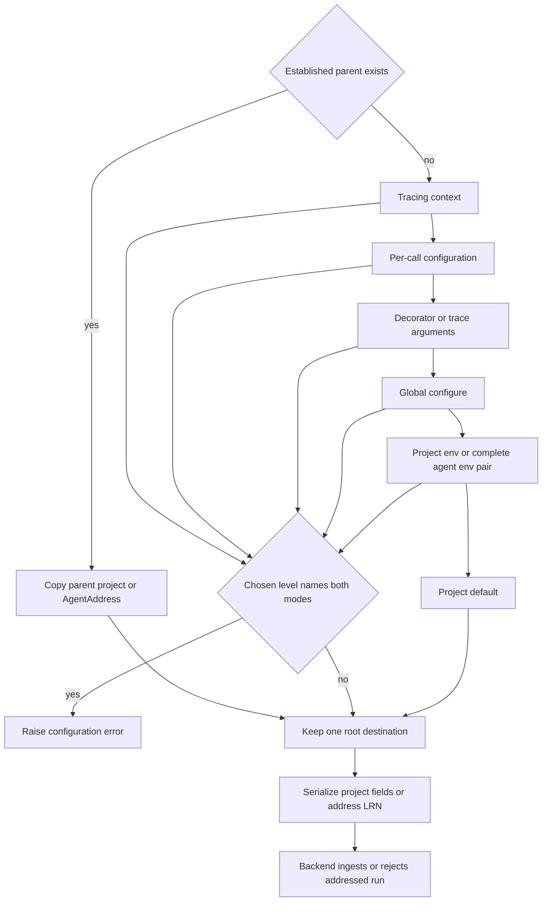

# Trace Destinations and Feature Addresses

Feature addressing is a **beta, workspace-enabled** alternative to naming a tracing project directly. A root trace has exactly one destination:

- a project, represented by `project_name`, `session_name`, or `session_id`; or
- an `AgentAddress(id, environment)`, which the backend maps to the tracing project for that agent environment.

This is routing, not a fallback mechanism. If a workspace does not support addressed ingestion, the backend rejects an addressed run; the SDK does not silently redirect it to a conventional project. Callers should therefore enable the feature for the workspace before adopting it.

## Address kinds and their boundaries

The public address classes are feature identifiers, not wire strings:

| Address type | Meaning | May receive runs or feedback? | May be resolved to a project? |
|---|---|---:|---:|
| `AgentAddress` | One agent environment | Yes | Yes |
| `ExperimentAddress` | The tracing project for an experiment UUID | No | Yes |
| `EvaluatorAddress` | The workspace's shared evaluator project | No | Yes |

`AgentAddress` is the **only ingestion destination**. Tracing entry points, replicas, and feedback validate for that concrete type; passing an `ExperimentAddress`, `EvaluatorAddress`, plain object, or LRN string is an error. By contrast, lookup operations accept all three address kinds. In particular, `client.sessions.resolve(address.to_api_address())` in Python or `client.sessions.resolve(address.toApiAddress())` in JavaScript returns the associated `session_id`, and run URL construction uses the same resolution path when it needs a project ID.

An agent ID is a lowercase DNS-label-like value: 1–63 lowercase ASCII letters, digits, or hyphens, beginning with a letter and ending with a letter or digit. Environments normalize to lowercase and must be one of `local`, `development`, `staging`, or `production`. Experiment IDs are canonical hyphenated UUIDs; `EvaluatorAddress` has no ID.

## Choosing one destination

At every precedence level, project and address are mutually exclusive. A level that names both is ambiguous and raises rather than choosing one. Naming a project at a higher level may legitimately override an address at a lower ambient level, and vice versa.

A child run is the first important exception to “root selection”: it copies the established destination of its parent. That keeps a trace in one destination even when nested code enters another tracing context or the receiver has conflicting environment defaults. A parent reconstructed from distributed headers has the same role; its destination outranks receiver-side per-call, decorator, global, and environment choices.

For a **Python `@traceable` root** with no established parent, the first level that names either mode wins, in this order:

1. `tracing_context(project_name=... | address=...)`
2. per-call `langsmith_extra` configuration
3. `@traceable(project_name=... | address=...)` decoration arguments
4. process-wide `ls.configure(project_name=... | address=...)`
5. `LANGSMITH_PROJECT` or the pair `LANGSMITH_AGENT_ID` and `LANGSMITH_AGENT_ENVIRONMENT`
6. project `default` when nothing else is named

For the Python `trace(...)` context manager, its own `project_name` or `address` argument is the explicit root-call choice, followed by the ambient tracing context, `ls.configure`, and the environment. In JavaScript `traceable`, extracted runtime configuration outranks decoration-time configuration; the resulting `RunTree` then inherits an existing parent destination or, for a root without an explicit destination, resolves from the environment.



*Destination lifecycle: children retain an established route, while roots select the first named level and serialize exactly one routing mode.*

The diagram expresses the common `@traceable` root order. The explicit Python `trace(...)` call places its own arguments ahead of ambient context as described above.

## Environment behavior is fail-closed

The environment address exists only when both `LANGSMITH_AGENT_ID` and `LANGSMITH_AGENT_ENVIRONMENT` are set and valid. The environment level is also invalid when it names both `LANGSMITH_PROJECT` and an agent address. Client construction warns about unusable ambient configuration.

Implicit tracing paths deliberately do not let those environment mistakes break application code. `@traceable`, `trace`, `RunTree`, and `create_run`/`createRun` catch the address-environment error, warn or log, and leave that call untraced. This is fail-closed: they do not guess a project and do not send a partially addressed trace. An explicit project or address selected at a higher level avoids consulting the bad environment.

Explicit Python `batch_ingest_runs` and `multipart_ingest` behave differently. They transform the caller-supplied batch synchronously; an unaddressed create that needs an invalid ambient destination raises `EnvAddressError` rather than silently dropping one item from a batch the caller assembled. Updates do not consult the environment because their destination is inherited from the original create or resolved by run ID. Malformed address wire data is likewise rejected locally before the batch reaches the backend.

## Parent and distributed propagation

In-process children copy `project_name`/`session_name` or the `AgentAddress` from their `RunTree`. The destination therefore remains stable across the whole trace.

Across services, `RunTree.to_headers()` writes the destination into W3C-style baggage:

- projects use `langsmith-project`;
- addresses use `langsmith-address`, whose value is the percent-encoded internal LRN;
- replicas use `langsmith-replicas`.

The receiving SDK reconstructs an `AgentAddress` from valid baggage. A baggage header that names both a project and an address is rejected as a distributed parent. An unusable address value is ignored without echoing the untrusted value; if a valid project is also present, that project remains usable. Replica baggage is filtered to header-safe routing fields so endpoint credentials and client objects are not propagated.

## Public object versus wire representation

Application code should construct an `AgentAddress`; it should not pass a string such as:

```text
lrn:agents/customer-support/environments/production
```

That LRN is an **internal wire and baggage representation**, not the public caller API. Immediately before ingestion, the SDK converts the address object to a single lowercase `address` payload field and removes null or absent project fields. The same conversion is idempotent for queued or retried batches: an already serialized LRN is parsed, validated, canonicalized, and sent again. A create naming a project does not consult the environment for an address, while an update never does.

The API-resolution representation is separate again: `to_api_address()` / `toApiAddress()` produces a structured value such as `{kind: "AGENT", id: ..., environment: "PRODUCTION"}`. It is used by the sessions resolution endpoint, not by run ingestion.

## Replicas

Replicas can independently target a project or an `AgentAddress`. Python accepts a bare `AgentAddress` in a replica sequence and normalizes it to `{"address": address}`; both SDKs validate an address stored in a replica object and reject non-agent address kinds. A replica object must not name both a project and an address when it is routed.

Addressed replicas participate in the same remapping machinery as project replicas. A different destination gets deterministic remapped run and trace IDs seeded by the destination's LRN, while a replica equal to the run's own destination keeps the original IDs. Children inherit replicas unless they provide their own; one-shot `reroot` behavior is stripped when JavaScript passes inherited replicas to a child. At most one replica may be marked `primary`.

When replicas cross baggage, only safe routing fields survive. A replica with an invalid address and no project is dropped; when both are present in received replica data, the project wins. This tolerant handling is limited to untrusted headers—locally supplied replica configuration is validated and errors normally.

## Feedback destinations

Feedback can be sent to an `AgentAddress` instead of a project/session ID. As with runs, the SDK rejects a feedback call that names both routing modes, and only an `AgentAddress` is accepted for ingestion. Serialization writes the same LRN to the feedback payload's `address` field. Feedback does not infer an address from the ambient agent environment: the caller supplies the feedback destination explicitly when it is needed.

## Resolving an address back to a project

`client.sessions.resolve(...)` is the inverse lookup boundary. It accepts the structured API form of `AgentAddress`, `ExperimentAddress`, or `EvaluatorAddress` and returns the tracing project/session ID. The result can be supplied to APIs that require a project ID.

Run URL construction uses this lookup when a run has no project ID but carries an address, or when the caller supplies a lookup address. It then builds the normal project/run URL from the resolved session ID. Resolution can return 404 when the address does not exist or the caller cannot read its project; generated API documentation also records that BYOC data planes may return 501 where resolution is unsupported.

## Safe change checklist

When extending destination handling:

1. Preserve the one-destination invariant at each caller-visible level.
2. Resolve only roots; children must retain the parent's destination.
3. Keep `AgentAddress` objects in SDK state and convert to LRN only at payload or baggage boundaries.
4. Validate untrusted baggage without exposing its raw value, and never propagate replica credentials.
5. Keep implicit tracing fail-closed on bad ambient configuration, but let explicit batch construction report errors.
6. Use the broad `Address` interface only for lookup and URL construction; ingestion must continue to require `AgentAddress`.
7. Test direct posts, updates, queued retries, distributed parents, replicas, feedback, and address-to-project resolution separately.
