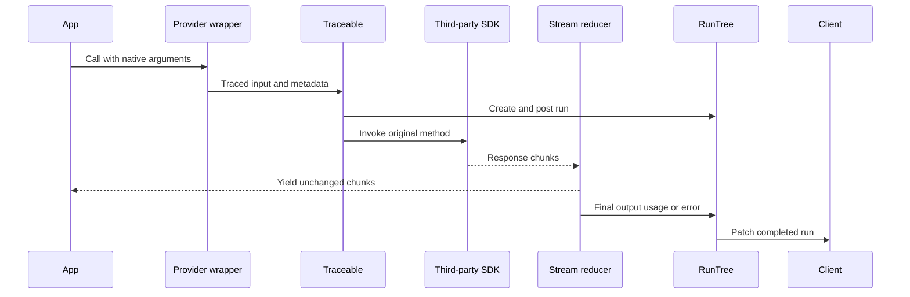
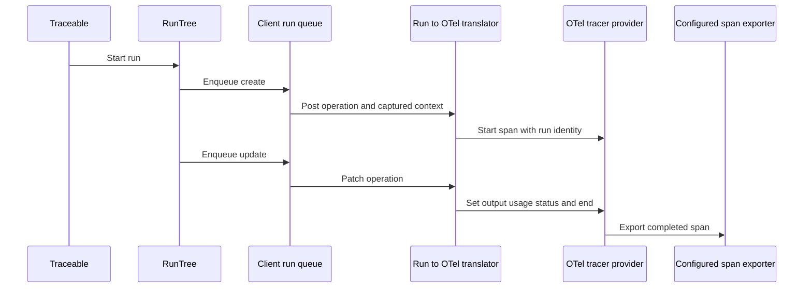

# Provider Wrappers, Agent Integrations, and OpenTelemetry

LangSmith integrations preserve a third-party API while adapting its observability model to a common lifecycle. A provider invocation becomes an `llm` run, a tool callback becomes a `tool` run, and agent orchestration becomes a hierarchy of `chain`, `tool`, and `llm` runs. The integration boundary also normalizes messages, stream chunks, token accounting, errors, metadata, and teardown.

Two OpenTelemetry paths must not be confused:

- **Native OTel ingestion** starts with spans emitted by an application or framework. A LangSmith span processor and OTLP exporter receive those spans directly. This path bypasses the `Client` run-operation queue.
- **SDK OTel tracing mode** starts with ordinary `RunTree` create and update operations. The client still queues those operations, but its batch worker translates them into spans instead of, or in Python `hybrid` mode in addition to, sending runs to LangSmith ingestion.

## Provider and composition wrappers

### Call-bound provider wrappers

The OpenAI, Anthropic, and Gemini wrappers in JavaScript and Python patch model-facing methods with useful semantics rather than replacing the whole SDK. They preserve sync, async, parse, raw-response, and streaming interfaces while routing calls through `traceable`. JavaScript `wrapOpenAI` rejects an already wrapped client to avoid duplicate runs. The broader `wrapSDK` recursively traces functions as `llm` calls and is best limited to the model-facing portion of an arbitrary SDK.

A provider wrapper supplies four policies to the shared tracing layer:

1. **Input normalization.** Provider requests become message-shaped traced inputs. JavaScript's Anthropic wrapper moves `system` into a leading system message in the traced copy and masks transport secrets and MCP credentials without changing the request sent to Anthropic.
2. **Invocation metadata.** Provider, model, model type, temperature, stop sequences, token limits, and selected invocation parameters are recorded under stable `ls_*` keys. Wrapper defaults and per-call metadata are merged.
3. **Output normalization.** Native responses become message- or completion-shaped outputs while retaining identifiers, finish data, and normalized `usage_metadata`.
4. **Streaming reduction.** Chunks are returned unchanged while a reducer accumulates the final traced output. SDK conveniences such as `finalMessage`, `finalResponse`, and `finalChatCompletion` still consume the underlying stream. Normal exhaustion, explicit close or context exit, cancellation, and iteration errors are lifecycle events, not merely return-value details.

Usage conversion is semantic. Anthropic cache-read and cache-creation tokens are additive input tokens and remain visible in `input_token_details`. OpenAI Realtime delegates to the shared OpenAI usage mapper, including cached and audio token details where available.



*Provider wrappers preserve the SDK stream while reducing consumed chunks into one completed run.*

A stream object returning does not complete its run. JavaScript's trace tap captures OTel context while reading, records `new_token` events for LLM runs, patches on exhaustion, records source errors with partial output, and marks cancellation as an error. Applications should therefore consume or explicitly close streams.

### Composition wrappers

The Vercel AI SDK integration wraps orchestration rather than one provider. `wrapAISDK` exposes traced text, stream, and object generation functions and a wrapped `ToolLoopAgent` where supported. An outer operation is chain-like, `LangSmithMiddleware` creates a child `llm` run, and tool `execute` functions become child `tool` runs. Base options merge with per-call `providerOptions.langsmith`; separate child input and output processors prevent an outer formatter or redactor from being applied accidentally to model children.

For model streams, the middleware passes each chunk through a `TransformStream` and collects text, reasoning, tool calls, provider metadata, finish reason, and usage. At flush it creates a message-shaped output, ends the child, and patches it. Raw HTTP request and response fields are excluded unless `traceRawHttp` is enabled.

Agent classification is contextual. Existing `ls_agent_type` values are preserved. Runs directly beneath tools can be classified as `subagent`, while a true top-level integration can default to `root`; this metadata supplements, rather than replaces, parent-child structure.

## Callback, realtime, and voice lifecycles

### Agent SDK processors

Some agent SDKs expose trace and span callbacks instead of a function suitable for decoration. JavaScript `OpenAIAgentsTracingProcessor` maps that lifecycle into `RunTree`:

- trace start creates a root or nested `chain` and installs it in `AsyncLocalStorage`;
- span start classifies agent, handoff, generation, response, function, and guardrail data;
- generation or response completion supplies meaningful root input and the latest root output;
- span and trace end post runs delayed for missing input, patch runs already posted, record errors, and restore context;
- `forceFlush` and `shutdown` delegate to the LangSmith client.

Synchronous context installation is necessary because the Agents SDK callbacks do not wrap one application function. It lets a nested `traceable()` tool attach to the active agent span, but restoration assumes matching start and end callbacks execute in the SDK's expected async task. Installing the processor is explicit tracing opt-in, so processor-created roots and inherited children trace even when `LANGSMITH_TRACING` is unset.

Processor metadata and per-trace metadata are merged and marked with `ls_integration`. OpenAI Agents `groupId` maps to `thread_id`; a supplied `ls_agent_type`, including explicit null opt-out, is preserved. Guardrails classify as `middleware`, and agents beneath tools classify as `subagent` without overwriting existing middleware, subagent, or compaction tags.

Claude Agent SDK follows the same lifecycle principle with a streamed event source. Its wrapper observes messages and additive tool and subagent hooks, always calls `StreamManager.finish()` in `finally`, strips MCP connection details from traced options, and merges top-level message fragments into the final conversation while preserving the original generator's extra methods.

### Realtime and voice sessions

OpenAI Realtime treats the session as lifecycle owner. Its connection proxy delegates normal methods while observing async iteration and `recv`. A session context creates the conversation root, applies `thread_id`, and guarantees best-effort teardown. Meaningful events create spans while noisy deltas are folded into side state. `response.done` records normalized model output, metadata, and usage; transcript events build the conversation rollup. Teardown closes an active event span, records body errors, and finalizes transcript and optional audio.

LiveKit and Pipecat already emit native OTel spans. Their processors use a **translate-then-forward** chain: `BaseLangSmithSpanProcessor` captures thread context at start, builds a translated draft at end, adds static metadata and cached `thread_id`, lets a framework subclass classify it, rebuilds a fresh `ReadableSpan`, and only then forwards it. A sibling exporter could race and export the original span. Translation failures are isolated and may forward the untranslated original. Audio attachments are base64 encoded and size-capped by default.

## OpenTelemetry ownership and transport

### Optional dependencies and provider ownership

OpenTelemetry remains optional. JavaScript's singleton imports no OTel packages and supplies no-op trace and context implementations until initialized. If SDK OTel mode is selected without initialization, tracing warns once while the application function still executes. The deprecated experimental initializer requires the OTel API, base trace SDK, OTLP protobuf exporter, and async-hooks context manager as peer dependencies.

Python imports OTel helpers lazily. Constructing public OTel components without extras gives an actionable `pip install langsmith[otel]` error. A `Client` in `otel` or `hybrid` mode uses a caller-supplied provider, reuses an existing real global provider, or creates and registers an internal OTLP provider only while the global provider is still proxy/no-op. Missing packages produce a warning and fall back to LangSmith-only tracing.

An existing application tracer provider must receive an added LangSmith processor; it must not be replaced:

- Python `langsmith.integrations.otel.configure()` bootstraps a fresh LangSmith-only setup only while OTel is unowned. Otherwise add `OtelSpanProcessor` with `provider.add_span_processor(...)`.
- JavaScript `initializeOTEL()` may create and register a `BasicTracerProvider` only when no provider was supplied. When `globalTracerProvider` is passed, the function returns and records the LangSmith processor but does **not** attach it; the application must add or construct the provider with that processor using its OTel SDK version's API. Set `skipGlobalContextManagerSetup: true` when another runtime already owns context.

### Native spans: processor to OTLP

JavaScript `LangSmithOTLPSpanProcessor` exports only spans marked `langsmith.traceable` or carrying `ai.operationId`. It tracks all spans in each trace long enough to find the nearest exported ancestor through unexported intermediary spans, stamps root or parent attributes, and removes trace bookkeeping after every span ends. Shutdown first waits for pending shared-client `RunTree` batches and then shuts down the underlying batch processor.

Before export, `LangSmithOTLPTraceExporter` can run async `transformExportedSpan`, translate AI SDK prompt, completion, metadata, model/tool operation, and usage fields, apply a default project as `langsmith.trace.session_name`, and skip export successfully when environment tracing is disabled. This exporter mutates the export-time span attributes; voice translation instead rebuilds read-only `ReadableSpan` objects.

Python's public `OtelSpanProcessor` wraps `OtelExporter` in `BatchSpanProcessor` by default, accepts another processor class, and can stamp OTel-safe `langsmith.metadata.*` values on every span at start. `force_flush` and `shutdown` forward to the owned processor.

### Endpoint and header resolution

For OTLP/HTTP the current LangSmith default is a `POST` to:

```text
https://api.smith.langchain.com/otel/v1/traces
```

JavaScript native export and Python's internally created SDK-mode provider use standard OTel endpoint precedence:

1. an explicit JavaScript exporter `url`, when supplied;
2. `OTEL_EXPORTER_OTLP_TRACES_ENDPOINT` as the complete traces URL;
3. `OTEL_EXPORTER_OTLP_ENDPOINT` as a base URL with `/v1/traces` appended;
4. otherwise `{LANGSMITH_ENDPOINT}/otel/v1/traces`.

A base endpoint already ending in `/traces` is temporarily preserved unchanged and warns once that this compatibility fallback will be removed in the v1 SDK release. Move such a complete URL to `OTEL_EXPORTER_OTLP_TRACES_ENDPOINT`. Values such as `/not-traces` are bases and still receive `/v1/traces`. Resolution is passed to the exporter without mutating environment variables.

`OTEL_EXPORTER_OTLP_HEADERS` takes precedence over generated LangSmith headers. Otherwise the internal providers derive `x-api-key`; Python also adds `Langsmith-Project` when configured. JavaScript's exporter derives its project separately and stamps it as the session-name span attribute. An explicit JavaScript `headers` object overrides environment and generated headers.

Python's public `OtelExporter` is a narrower convenience API: its explicit `url` is already a complete OTLP traces URL and otherwise defaults to `{LANGSMITH_ENDPOINT}/otel/v1/traces`; it merges `x-api-key`, caller headers, and `Langsmith-Project`. `OtelSpanProcessor(url=...)`, by contrast, treats that argument as a LangSmith base and appends `/otel/v1/traces`.

### Queued runs: RunTree operations to spans

`RunTree` uses create then update semantics. `postRun()` sends normalized initial data. `patchRun()` sends completion fields and excludes inputs by default because an update merged with its create during batching would otherwise overwrite initial inputs; `excludeInputs: false` opts in to sending them.

In SDK OTel mode, those same queued operations feed a translator:



*SDK OTel mode preserves the queued create-update lifecycle but translates the batch into spans instead of directly ingesting native spans.*

Python supports `langsmith`, `otel`, and `hybrid`: workers drain the same queue to LangSmith, OTel, or both. Its internal `OTELExporter` derives deterministic trace and span IDs from run UUIDs, preserves a captured application OTel parent for roots, and prefers an in-flight parent run span for children. JavaScript OTel mode uses the OTel span captured with each queued create and skips a create when no active span is available.

Both translators map LangSmith names, run kinds, projects, tags, metadata, prompt/completion JSON, status and exceptions, model/request fields, and token usage into LangSmith and GenAI attributes. Tool runs expose `gen_ai.tool.name` and prefer the run's `extra.tool_call_id` over metadata fallback. Tool definitions pass through provider-native shapes. Output usage overrides metadata usage where the JavaScript translator has both.

Python emits `gen_ai.response.finish_reasons` as a list: all OpenAI choice reasons are preserved, with Anthropic `stop_reason` and Gemini-style top-level `finish_reason` as fallbacks. Missing reasons are omitted, and a provider reason containing a comma remains one value. The current JavaScript translator gathers OpenAI choice reasons and stores them as a comma-separated attribute. Both preserve full serialized output separately.

Python's in-flight span store is lock-protected because background queue workers can export concurrently. Every batch performs rate-limited TTL cleanup; an orphan older than `LANGSMITH_OTEL_SPAN_TTL_SECONDS` (default 3600 seconds) is atomically removed and ended. A normal update with `end_time` ends and removes its span. JavaScript retains open spans in a map until the matching patch ends them; it currently has no equivalent TTL cleanup in `LangSmithToOTELTranslator`.

## Privacy, failure, and shutdown rules

- Apply input, output, and metadata processors before data reaches a run or span. Return transformed copies rather than mutating provider arguments.
- Raw HTTP capture and audio attachments increase volume and may expose credentials or user content; enable them explicitly. Provider wrappers redact known transport secrets, but arbitrary prompt and completion data remains application-controlled.
- Translation is best-effort at integration boundaries. Individual queued operations log and continue after conversion failures; absent creates make later patches no-ops rather than inventing spans.
- Flush the component that owns buffering. Provider and agent processors flush their LangSmith client; native OTel processors need `force_flush` or `shutdown`; JavaScript's filtering processor waits for pending `RunTree` batches before base shutdown; realtime contexts and streamed generators must exit or finish.

## Focused verification

High-value tests lock down behavior rather than wrapper existence:

- `js/src/tests/wrapped_openai.test.ts` verifies only creation calls are traced, retrieval remains untouched, streams preserve chunks, and normalized metadata and usage reach runs.
- `js/src/tests/openai_agents_sdk.test.ts` exercises delayed post/patch ordering, nested context, `groupId` mapping, agent-type defaults and opt-outs, usage, errors, flush, and cleanup.
- `js/src/tests/otel_exporter.test.ts` sends real OTLP/HTTP requests to verify `POST`, endpoint precedence, no environment mutation, and the one-time legacy `/traces` warning.
- `js/src/tests/otel_translator.vitesttest.ts` covers create/update span completion, metadata, tool-call fields, and usage precedence.
- `python/tests/unit_tests/test_otel_exporter.py` verifies endpoint and header defaults, standard overrides, finish-reason shapes, tool calls and definitions, OTel-safe metadata, string I/O, TTL cleanup, and concurrent store mutation.
- Span utility tests verify translated `ReadableSpan` objects preserve untouched fields and do not mutate their source.

When extending an integration, test non-streaming plus partial and failed streaming, sync and async variants, finish and usage detail fields, tool-call IDs, parent restoration, metadata override precedence, filtering, and explicit flush or teardown. These are the boundaries where API-compatible instrumentation most often produces an incomplete or incorrectly nested trace.
