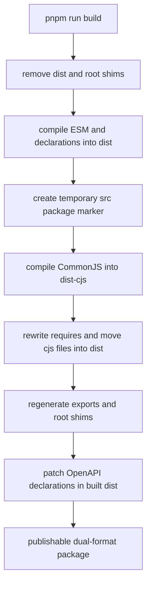
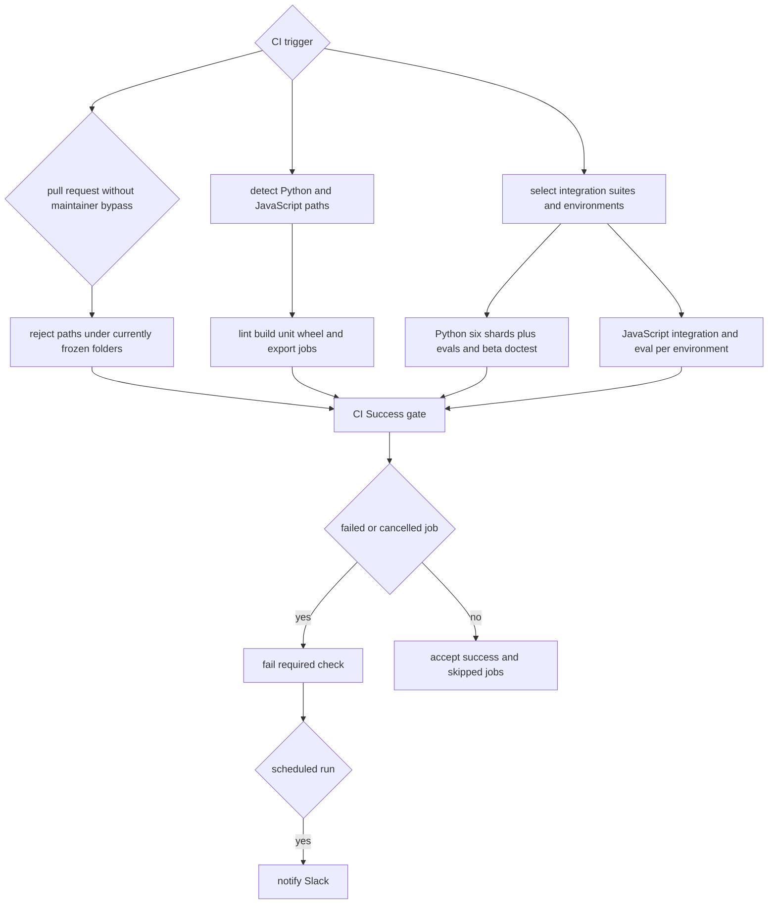
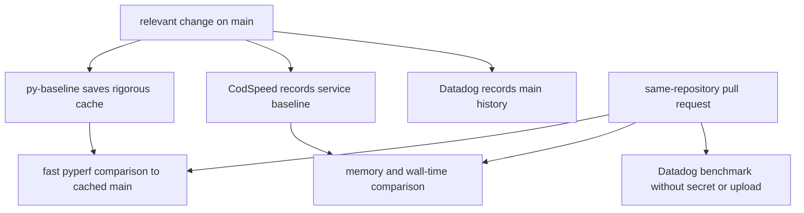
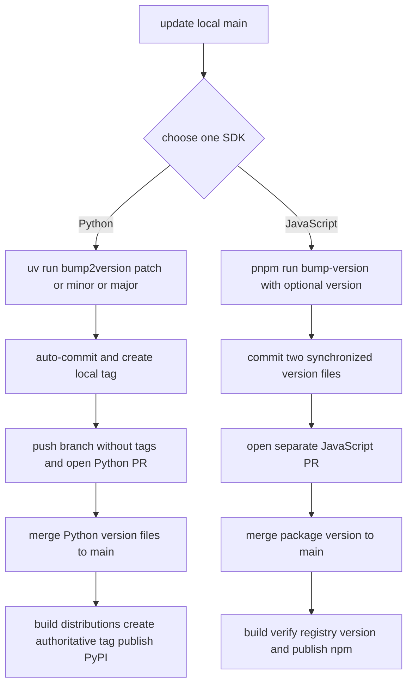

# Development, Generated Code, Builds, Mirroring, and Releases

This repository contains independently built Python and JavaScript SDK distributions, but active development is moving toward language-specific repositories. Choose the correct repository first, then work from the relevant language directory and use its wrapper commands. For component and public API boundaries, see [Dual-SDK Architecture and Public Surfaces](../architecture/sdk-architecture.md); for suite scope, see [Repository Test Strategy](../testing/repository-test-strategy.md).

## Route work before coding

The current routing rules are operational controls, not suggestions:

- **JavaScript is frozen in this monorepo.** The main CI workflow currently sets `FROZEN: "js"`. A pull request that adds, changes, deletes, or renames a path under `js/` fails the `Freeze Guard`. Internal contributors should open JavaScript work in `langchain-ai/langsmith-javascript-staging`; external contributors should use `langchain-ai/langsmith-javascript`.
- **Maintainer exception:** only maintainers may add `skip-freeze-guard`, and only for a revert or hotfix that must ship from this repository. The guard then skips, which the final success gate accepts. Do not use the label as a routine bypass.
- **Python is not currently in `FROZEN`.** `CONTRIBUTING.md` nevertheless identifies the language-specific staging repositories as the future homes and says to open new work there when possible.
- **External pull requests do not run Actions directly.** A maintainer must first review the complete external diff and commits, cherry-pick explicit reviewed SHAs with `-x` onto a clean internal branch, review conflict resolutions and the final diff, and open a replacement PR that credits and links the contributor. Later external commits require the same explicit review; never automatically synchronize them or approve workflows on the original PR.

Every merge to `main` that touches `python/` or `js/` is mirrored hourly, one PR at a time, into the corresponding language staging repository with paths rewritten. This mirror deliberately does **not** carry `pyproject.toml`, `package.json`, or lockfile changes. Port those manifest and lockfile changes manually so the split repository receives dependency, package metadata, and resolution updates along with the mirrored source change.

## Generated source versus regenerated build artifacts

The trees `python/langsmith/_openapi_client/` and `js/src/_openapi_client/` are generated by Stainless. **Never edit either `_openapi_client` source tree manually.** A later synchronization would overwrite the edit. The `Protect OpenAPI Client` workflow runs on pull requests targeting `main` that touch either tree and accepts only a head branch named `sync/langsmith-api` authored by `langtions-bot[bot]`; all other sources fail.

Generated API changes arrive through the external `stlc_sync_python_and_js_sdks` workflow in `langchain-ai/langchainplus`. Put handwritten adapters and compatibility behavior outside the generated source trees. If the generated contract must change, use the upstream generation and synchronization process linked from `CONTRIBUTING.md`.

JavaScript also has **regenerated build artifacts**, which are different from generated OpenAPI source. Root entrypoint shims and `dist/` are recreated by the build and are not the source of truth. `js/scripts/create-entrypoints.js` is the public-subpath extension point: its `entrypoints` map drives `package.json` exports and included files, TypeDoc entrypoints, root `.js`, `.cjs`, `.d.ts`, and `.d.cts` shims, and the generated `.gitignore` section.

## Local contributor loop

### Python

Use `uv` from `python/`:

```bash
cd python
uv sync --group dev --group lint
make format
make lint
make tests
```

`make format` runs Ruff formatting and Ruff autofixes. `make lint` runs Ruff and MyPy. `make tests` runs unit tests in parallel with Python development and asyncio debug modes enabled, removes tracing configuration from the environment, and disables network sockets except Unix sockets. Unexpected network access should be fixed rather than weakening this isolation.

Focus a run with `TEST`, including arbitrary pytest options:

```bash
TEST=tests/unit_tests/test_client.py make tests
TEST='tests/unit_tests/test_client.py -k create_run -x' make tests
```

Build the source distribution and wheel with:

```bash
make build
# equivalent to: uv build
```

Before changing dependencies or generated-client packaging, run:

```bash
make test-wheel-imports
```

This strict check builds without workspace sources, installs the wheel with `--no-deps` into a clean virtual environment, installs only dependencies declared in `pyproject.toml`, and imports and constructs both generated and handwritten clients. It catches checkouts that pass only because a development or transitive dependency masks an undeclared runtime requirement. The distribution uses Hatchling, reads its version from `langsmith/__init__.py`, supports Python 3.10 and later, and packages the `langsmith` tree.

### JavaScript / TypeScript

For work routed to the appropriate JavaScript repository, use the pinned pnpm major and run from `js/` in this checkout:

```bash
cd js
pnpm install --frozen-lockfile
pnpm format
pnpm lint
pnpm test
pnpm run test:vitest
pnpm run build
```

`pnpm format` writes `oxfmt` formatting and `pnpm lint` runs `oxlint`, excluding generated OpenAPI source. `pnpm test` runs Jest while excluding integration tests, and `pnpm run test:vitest` exercises the Vitest-facing surface. To focus a Jest file:

```bash
NODE_OPTIONS=--experimental-vm-modules npx jest src/tests/context.test.ts
```

A successful build also validates types and the package surface. CI installs from the frozen lockfile and separately checks formatting, linting, build/type correctness, Jest and Vitest behavior, and installed-package compatibility in ESM, CJS, Cloudflare, Vite, Webpack, esbuild, and Metro environments. Run the relevant export environment whenever changing entrypoints, module formats, declarations, exports, or dependency boundaries.

## How the JavaScript package build works



*The JavaScript build creates ESM and CommonJS implementations, regenerates the public package boundary, and applies declaration-only compatibility fixes to built output.*

The build cleans `dist/` and generated root shims. `build:esm` removes a stale `src/package.json`, compiles NodeNext ESM and declarations into `dist/`, and removes compiled tests. `build:cjs` temporarily writes `{}` to `src/package.json`, compiles into `dist-cjs/`, rewrites relative `require` targets from `.js` to `.cjs`, moves the results into `dist/`, and removes the temporary directory and marker. The entrypoint generator then creates aligned import, require, and declaration routes and synchronizes package configuration.

Finally, `fix-openapi-client-declarations.js` patches known incompatibilities only in built `dist/_openapi_client` declarations. This does not authorize edits to `js/src/_openapi_client/`. Its expected-snippet checks intentionally turn generated-code drift into a build failure. If CommonJS compilation is interrupted, remove a leftover `js/src/package.json`; a subsequent full build also removes it during the ESM phase.

To add or remove a public subpath, change the `entrypoints` map, run the full build, and review synchronized `package.json` and `tsconfig.json` changes. Do not maintain only one module format: every public subpath needs aligned ESM, CommonJS, `.d.ts`, and `.d.cts` routes.

## Main CI, integration matrices, and the freeze gate

The main `CI` workflow runs for pushes to `main`, pull requests targeting `main`, nightly at 03:17 UTC, and manual dispatch. Runs with the same workflow, event type, and ref share a concurrency group; a newer run cancels the older one.



*The main CI workflow combines path selection, the frozen-folder policy, language checks, integration matrices, and one required success decision.*

Ordinary lint, build, unit, compatibility, and export jobs select Python for `python/**`, JavaScript for `js/**`, and both for `.github/**`; nightly selects both regardless of paths. Integration selection is intentionally narrower and event-dependent:

- Pull requests select Python for changed `python/**/*.py` files and JavaScript for changed JS/TS-family source files; a `release` label opts both in.
- Pushes run both integration families against beta.
- Manual dispatch can enable each language independently, choose beta, one of the three v16 environments, or all environments, and configure Python `-x` and JavaScript `--bail` behavior.
- Nightly runs beta, ClickHouse-only, dual, and SmithDB-only matrices, with environment-specific marker exclusions and no Python exit-first behavior.
- Python runs six integration shards and one eval job per environment, plus doctests once on beta. JavaScript integration and Vitest eval jobs are unsharded. The Bun smoke test runs unconditionally in the workflow.

The final `CI Success` job waits for the declared checks, including `Freeze Guard`. Skipped jobs are acceptable; any failure or cancellation fails the gate. Only a failed scheduled gate sends the Slack notification.

## Python benchmark operations

The benchmark workflows answer different questions and are not interchangeable:

| Workflow | Trigger and runner | Dependencies and command | Baseline/reporting and secrets |
|---|---|---|---|
| `py-bench.yml` | Pull requests changing `python/langsmith/**`; GitHub-hosted `ubuntu-latest`; Python 3.11 | `uv sync --group dev`, then `make -s benchmark-fast` | Restores the required cache produced by `py-baseline.yml`, compares PR output to main with `pyperf compare_to`, and annotates the PR. A cache miss fails. It uses no reporting secret. |
| `codspeed.yml` | Relevant Python source, benchmark, Makefile, dependency, lockfile, or workflow changes on same-repository PRs and `main`, plus manual dispatch; `codspeed-macro` bare-metal ARM64 runner; Python 3.13 | `uv sync --group dev --group bench`, then `bench/test_bench.py` through pytest-codspeed with pytest timeout disabled | Main runs establish the CodSpeed comparison baseline. Separate memory and wall-time matrix legs run with fail-fast disabled; simulation is disabled because Valgrind is too slow on ARM64. Authentication uses job OIDC (`id-token: write`), not a repository API-key input. Fork PRs are skipped. |
| `py-bench-datadog.yml` | The same broad source/setup path family on same-repository PRs and `main`, plus manual dispatch; GitHub-hosted `ubuntu-latest`; Python 3.13 | `uv sync --group dev --group bench`, then `make benchmark-datadog` | PRs run the benchmark but intentionally skip Datadog setup and upload. Main/manual runs put the project venv on `PATH`, configure Datadog immediately before the benchmark with `DD_API_KEY`, and report main-branch history to the `us5.datadoghq.com` site. Fork PRs are skipped. |

`py-baseline.yml` is the state owner for the legacy `py-bench.yml` comparison. On relevant pushes to `main` or manual dispatch it runs the rigorous `make benchmark`, saves `out/benchmark-baseline.json` under an OS-and-commit cache key, and lets PR jobs restore the newest matching OS baseline.



*Python performance workflows maintain separate cached, CodSpeed, and Datadog histories with different trust and reporting boundaries.*

For local investigation, `make benchmark` is rigorous, `make benchmark-fast` is the short pyperf run, and `make benchmark-codspeed` or `make benchmark-datadog` exercise the common pytest benchmark cases. The `bench` dependency group is intentionally separate from `dev` and is needed for the pytest-based CodSpeed and Datadog targets.

## Release authority and invariants

The **“Cutting a release” section of `CONTRIBUTING.md` is the exclusive release procedure**. Workflow internals, historical tags, or package-manager capabilities do not define an alternative process. Python and JavaScript releases require **separate, narrowly scoped version-bump PRs** against `main`. Never combine both SDK bumps, publish from a workstation, or push a release tag.



*Each SDK has its own version-bump PR and independently triggered publication workflow.*

### Python release PR

From current `main`, create a dedicated branch and run from `python/`:

```bash
git checkout main && git pull
git checkout -b release-py-X.Y.Z
cd python
uv run bump2version patch   # or minor/major
```

Do not hand-edit `.bumpversion.cfg` or `langsmith/__init__.py`. The bump configuration synchronizes them, commits, and creates a local `vX.Y.Z` tag. That local tag is not authoritative: do not push it and do not use `--tags` or `--follow-tags`.

```bash
git push origin release-py-X.Y.Z
gh pr create --title "release(py): X.Y.Z"
```

Keep the PR to `.bumpversion.cfg` and `langsmith/__init__.py`. After merge, the change to `python/langsmith/__init__.py` triggers the Python workflow. It reads the version, rejects an existing `vX.Y.Z` tag during the normal main flow, runs `uv build`, creates the authoritative GitHub release and tag at the merged commit, and publishes `python/dist` to PyPI via trusted publishing.

### JavaScript release PR

Use a different dedicated branch and run from `js/`:

```bash
git checkout main && git pull
git checkout -b release-js-X.Y.Z
cd js
pnpm run bump-version   # or: pnpm run bump-version X.Y.Z
```

Without an argument, the script increments the patch component; with an argument, it uses that version. It synchronizes `package.json` and the exported `__version__` in `src/index.ts` but does not commit. Do not hand-edit either file, use another bump mechanism, or push a tag.

```bash
git add package.json src/index.ts
git commit -m "release(js): X.Y.Z"
git push origin release-js-X.Y.Z
gh pr create --title "release(js): X.Y.Z"
```

After merge, the `js/package.json` change triggers the JavaScript workflow. It installs from the frozen lockfile, performs a full build, verifies `package.json` and `src/index.ts` agree, and queries npm. It runs `npm publish` only when the repository version is greater than the published `langsmith` version. Contributors do not create or push a JavaScript release tag.

Both workflows expose `workflow_dispatch` with `dangerous-non-main-release=true`. This is an exceptional maintainer-controlled override, not a second contributor release process. The normal, exclusive path remains the separate PR procedures in `CONTRIBUTING.md`.

## Failure checklist

- **`Freeze Guard` fails:** move JavaScript work to the repository named in the check. Only a maintainer handling a required revert or hotfix may apply `skip-freeze-guard`.
- **A mirrored change lacks dependency metadata:** manually port `pyproject.toml`, `package.json`, and lockfile changes; the hourly mirror excludes them.
- **`Protect OpenAPI Client` fails:** restore generated source and move handwritten behavior outside it, or obtain the change through the authorized upstream sync PR.
- **Python source tests pass but wheel imports fail:** declare genuinely imported runtime requirements in `pyproject.toml`; do not rely on development or transitive dependencies.
- **A benchmark PR cannot restore its baseline:** run or repair `py-baseline.yml`; `py-bench.yml` intentionally fails on a cache miss.
- **A JavaScript import works in only one runtime:** run the full build and matching export environment, then inspect exports, root shims, declarations, and ESM/CommonJS targets as one unit.
- **`check-version` fails:** rerun `pnpm run bump-version`; do not repair the two version files independently.
- **A release trigger behaves unexpectedly:** do not compensate with tags. Verify the merged version files and registry/tag state, then follow `CONTRIBUTING.md` and maintainer guidance.
