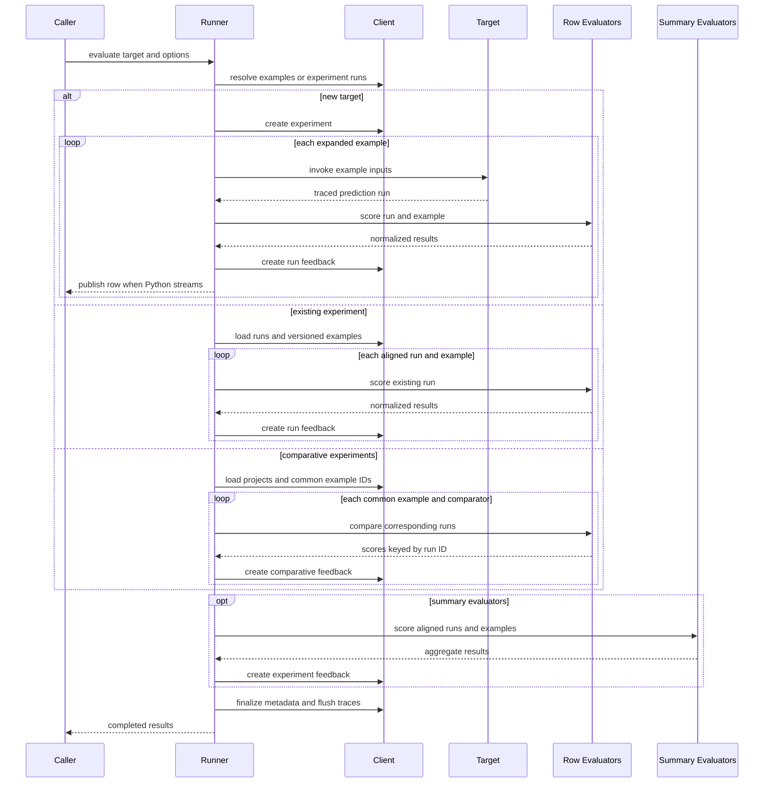

# Evaluation and Experiment Workflows

Evaluation is orchestration around traces. It resolves examples, creates or reuses an experiment (a tracing project), runs a target when needed, keeps each root run paired with its reference example, invokes evaluators, and records normalized evaluator output as feedback. Python exposes synchronous `evaluate`, asynchronous `aevaluate`, and explicit existing-experiment helpers. JavaScript exports `evaluate` for callable targets and comparative experiment arrays; direct `evaluateComparative` remains available but is deprecated.

## Choose the path by who owns the runs

| Path | Input | Prediction phase | Destination |
| --- | --- | --- | --- |
| New target | Callable or LangChain `Runnable`, plus dataset data | Invokes the target for every expanded example and traces each call into a newly created experiment, or the advanced `experiment` supplied in Python | Row feedback targets prediction runs; summary feedback targets the experiment |
| Existing experiment | One experiment name, ID, or `TracerSession` in Python | No prediction; loads the experiment's runs and reconstructs their examples at the recorded dataset version | Adds row and summary feedback to the existing runs and experiment |
| Comparative | Two existing experiments through Python `evaluate`, or at least two experiment names/results in JavaScript | No prediction; loads each experiment and compares runs sharing a `reference_example_id` | Creates a comparative experiment and per-run preference feedback linked to it |

An existing experiment is not another dataset selector. Its runs and `reference_dataset_id` determine the evaluation population. `load_nested` / `loadNested` controls whether child traces are reconstructed beneath roots for evaluator inspection; roots remain the scoring units.

*Caption: New-target, existing-experiment, and comparative evaluation differ in run selection, while sharing example alignment and normalized feedback handling.*

## New-target lifecycle

`data` can resolve from a dataset name, dataset UUID, a Python `Dataset`, or supplied synchronous/asynchronous examples as supported by the entrypoint. Attachments are fetched only when the target or evaluators declare an attachments parameter. When the same attachment can be consumed repeatedly, Python preserves its bytes and recreates readers. `num_repetitions` expands examples in repetition-major order: one full pass over the source examples for each repetition.

Starting a manager requires a first example. The runner generates a name or adds a random suffix to `experiment_prefix`, creates a project tied to that example's dataset, and retries naming conflicts up to ten times. It includes source example count, repetition count, best-effort evaluator keys, revision metadata, and Git metadata when available. When prediction finishes, the manager updates the project with the newest example modification time as `dataset_version` and the observed dataset splits. Existing and comparative evaluation later use that version to recover the same reference state.

Each prediction is wrapped as a traceable call under the experiment project. The wrapper passes example inputs and optional attachments, and associates the root run with `reference_example_id` plus `example_version`. That reference ID is the durable join between traces and examples. See [Run Tree and Context](/openwiki/concepts/run-tree-and-context.md) for trace construction and [Platform Client](/openwiki/concepts/platform-client.md) for project, run, dataset, and feedback operations.

Evaluation deliberately owns these trace destinations. Target runs explicitly name the experiment project, while evaluator runs explicitly name `evaluators`; in Python the evaluator context also clears an ambient structured `address` when changing the project. This prevents a surrounding agent or tracing context from redirecting evaluation traces away from the experiment that will own their feedback. This is a workflow-specific override, not a replacement for the general [Trace Destinations and Addressing](/openwiki/concepts/trace-destinations-and-addressing.md) precedence rules.

Python supports `upload_results=False` only for a new target. It skips explicit remote experiment creation and all row and summary feedback uploads but still returns local rows and scores. The synchronous target path also selects local tracing, and evaluator tracing uses local mode unless disabled. Existing and comparative paths reject this option because their identity and destination are remote experiments. JavaScript evaluation always follows the client-backed experiment and feedback path.

## Scheduling, concurrency, and ordering

Work quantity and active work are separate concerns:

- `num_repetitions` controls how many prediction rows are created. Concurrency controls only how those rows progress.
- In both SDKs, a concurrency value of zero means sequential execution. Python uses `None` for no explicit caller-supplied limit. JavaScript creates a shared queue only for a positive `maxConcurrency`; a stage without a supplied queue creates its own one-at-a-time queue when its resolved limit is zero.
- Python synchronous evaluation uses separate context-propagating thread pools for prediction and row scoring. Both receive the same `max_concurrency`, but they are independent pools; the lazy generators let completed predictions enter scoring while other predictions remain active.
- For a Python async callable with row evaluators, one task performs prediction and then all evaluators for an example. `max_concurrency` therefore caps whole per-example pipelines. Rescoring already-existing runs uses only the evaluator scheduler.
- JavaScript uses independent target and evaluator queues only when both `targetConcurrency` and `evaluationConcurrency` are explicitly supplied. Otherwise a positive `maxConcurrency` creates one shared queue for prediction and evaluation. If no shared queue is created, each stage constructs its own queue from its resolved stage limit.
- Evaluators for one row run in configured order. Concurrency is across rows, not across the evaluators attached to the same row.

Prediction and row evaluation are intentionally interleaved. Completion-order schedulers emit a fast prediction for evaluation without waiting for a slower prediction. Python preserves that completion order in its result stream; runs and examples stay aligned because each pipeline carries the pair together. Python summary evaluators consume the same aligned completion-order collections.

JavaScript also processes internal rows in completion order, but every row retains its original `exampleIndex`. `ExperimentResults.processData` drains all rows, sorts rows and the corresponding run array by that index, and only then invokes summary evaluators. Consequently returned JavaScript rows and summary arrays follow expanded dataset order even though prediction and scoring did not.

## Evaluator contracts and feedback normalization

A row evaluator receives a prediction `Run` and reference `Example`. Function adapters also support object or unpacked views such as `inputs`, `outputs`, `reference_outputs` / `referenceOutputs`, and attachments. A result identifies a feedback `key` and can carry a numeric or boolean `score`, categorical or structured `value`, `comment`, correction, feedback configuration, and source or target run IDs. Evaluators may return one result, a list, or an `EvaluationResults` batch; adapters normalize these forms.

`RunEvaluator` is the main row-level extension boundary. Plain functions are wrapped into it; custom implementations provide `evaluate_run` / `aevaluate_run` in Python or `evaluateRun` in JavaScript. Evaluator invocations are normally traced in the `evaluators` project, and that evaluator trace ID becomes `source_run_id` / `sourceRunId`, linking feedback to the computation that produced it. When evaluator tracing is disabled, upload payloads omit that source link rather than pointing to a nonexistent evaluator run.

Row feedback targets the scored run and is associated with the owning experiment. Summary evaluators do not run until all row results have been collected into aligned run/example arrays. They receive those arrays directly or normalized arrays of inputs, outputs, and reference outputs. Summary feedback strips any target run ID and is uploaded with `run_id=None` / `null` plus the project ID, so it belongs to the experiment rather than one trace.

Ordinary row and summary evaluator exceptions are isolated per evaluator: they are logged and later evaluators continue. JavaScript leaves the failed evaluator's result absent. Python attempts to infer the evaluator's feedback keys; when successful, it adds and, when enabled, uploads error results whose `comment` contains the exception and whose `extra.error` is true. If key inference also fails, Python logs without adding a result.

Feedback completion differs by path. JavaScript awaits row and summary feedback calls in the processing flow, then waits for pending trace batches before `evaluate` resolves. Python synchronous row and summary uploads are submitted to executors whose context managers wait for scheduled work; async summary uploads are awaited, while async row uploads use a dedicated feedback executor. Comparative JavaScript awaits evaluator and feedback promises as one aggregate operation. Comparative Python schedules feedback on its executor and waits for executor shutdown before returning.

## Existing experiments and comparative alignment

Python `evaluate(existing_experiment, ...)` delegates to `evaluate_existing`; `aevaluate` delegates to `aevaluate_existing`. The helper loads root runs by default. With `load_nested=True`, it loads all runs, attaches children sorted by `dotted_order`, and still returns roots. It reloads examples from the project's reference dataset with `as_of=project.metadata["dataset_version"]`, then maps each run through `reference_example_id`. There are no new predictions or repetitions.

Comparative evaluation applies stricter invariants:

1. At least two experiments and one comparator are required by the direct comparative runners. Python's top-level tuple form is exactly two; JavaScript accepts two or more.
2. Every experiment must reference the same dataset. JavaScript also requires a nonempty common-example intersection and warns when project dataset versions differ.
3. Only example IDs represented in every experiment are compared. Examples are fetched in batches at the first project's stored dataset version.
4. A comparator receives the corresponding runs and example. Optional randomization reduces positional bias, but returned scores remain keyed by run ID.
5. JavaScript rejects score IDs outside the supplied run set. Each accepted score becomes feedback on that run with the comparative experiment ID and evaluator source trace.

The call creates a separate comparative-experiment record containing source experiment IDs, metadata, and the reference dataset, and returns that record plus a comparison URL when one can be constructed. Comparative feedback is per example and per run; it is not summary feedback.

### Invalid combinations

Validate the selected path before expensive work begins:

- A new callable requires `data`. Python rejects unsupported extra keyword arguments, asynchronous callables passed to synchronous `evaluate`, and simultaneous `experiment` and `experiment_prefix`.
- A single existing experiment rejects `data`, `num_repetitions > 1`, `experiment`, `experiment_prefix`, and `upload_results=False`.
- A Python comparative tuple requires exactly two experiment identifiers and rejects `data`, repetitions, `experiment`, `summary_evaluators`, `disable_evaluator_tracing`, and `upload_results=False`. `aevaluate` does not support comparative targets; use synchronous `evaluate` with synchronous comparators.
- Direct comparative runners reject too few experiments, no evaluators, negative concurrency, and different reference datasets. JavaScript additionally rejects no common examples, and its top-level comparative dispatch requires evaluators.

These validation failures abort the call. Comparative comparator failures are also aggregate failures: JavaScript's `Promise.all` rejects, and Python calls `future.result()` after waiting. This differs from ordinary row evaluator isolation.

## Target failures, result consumption, and finalization

Target exceptions are caught and logged so other examples can continue. In Python, `error_handling="log"` sets `reference_example_id` before invocation, so a failed traced run remains associated with the example; `"ignore"` sets it only after success. Any other mode is rejected. JavaScript also logs target exceptions but then requires the tracing wrapper to have produced a run; if no run exists it raises “Run not created.” Its prediction generator attempts project metadata finalization in `finally`; when prediction and finalization both fail, the prediction error remains primary and the finalization error is logged.

Python synchronous `blocking=True` consumes rows and summaries before returning. With `blocking=False`, a background thread appends rows and wakes iterators as rows arrive. Iteration and `wait()` rethrow stored processing failures. The async result always owns a processing task; `async for` receives rows as the task appends them, and `await results.wait()` propagates task failure. Summary results appear only after all rows are consumed.

JavaScript does not provide caller-visible live streaming even though the returned object implements `AsyncIterable`. `evaluate` awaits `processData`, which collects and reorders every row, computes summaries, and then awaits pending trace batches. Iteration afterward reads the completed in-memory result array. Processing, feedback, and flush failures therefore reject the original `evaluate` promise.

Project finalization records dataset version and splits after prediction consumption, not after a later rescore of an existing experiment. Python skips finalization when uploads are disabled. JavaScript always attempts it for its new-target prediction path.

## Focused verification and safe-change checklist

The focused tests protect observable workflow behavior:

- Python runner tests exercise sync and async targets, uploaded versus local execution, blocking versus streaming consumption, repetitions, evaluator normalization, prediction/scoring interleaving, summaries, and rescoring an uploaded experiment.
- Python argument tests pin invalid existing and comparative combinations. Integration tests verify that inferable evaluator failures become keyed error feedback without dropping result rows.
- JavaScript runner tests prove completion-order mapping, independent target/evaluator limits, early scoring of fast predictions, stable final reordering, and sequential zero concurrency. Integration tests verify that rows, evaluations, and summary inputs all return to dataset order.

When changing this pipeline, preserve these invariants:

- every row carries the correct run/example pair even when completion order changes;
- summary runs and examples have identical ordering;
- JavaScript performs its final index reorder before summaries;
- experiment-owned target and evaluator destinations cannot leak to an ambient trace address;
- feedback targets the intended run, project, or comparative experiment;
- ordinary evaluator failures remain isolated while configuration, processing, and comparator failures remain observable to the caller.
