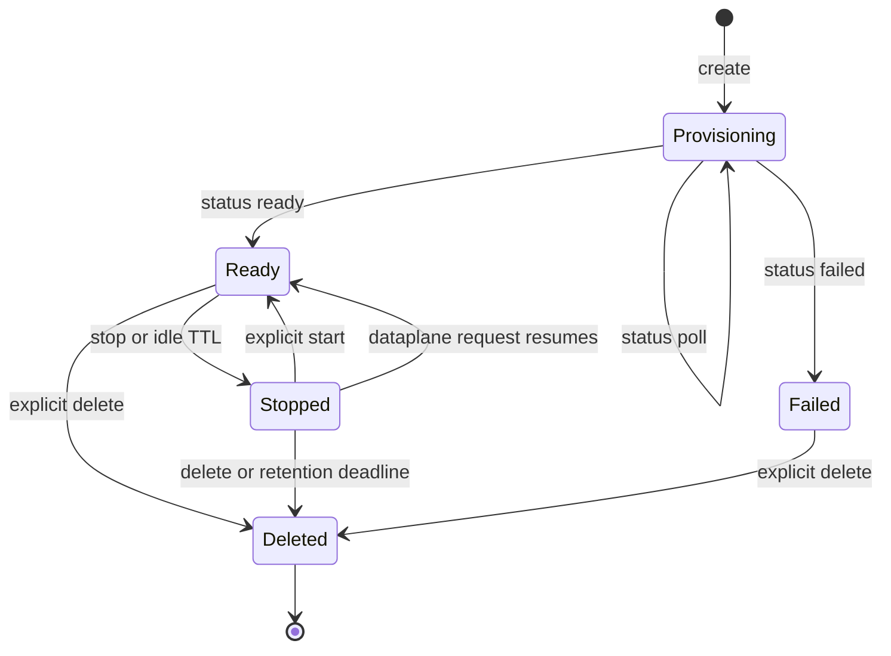
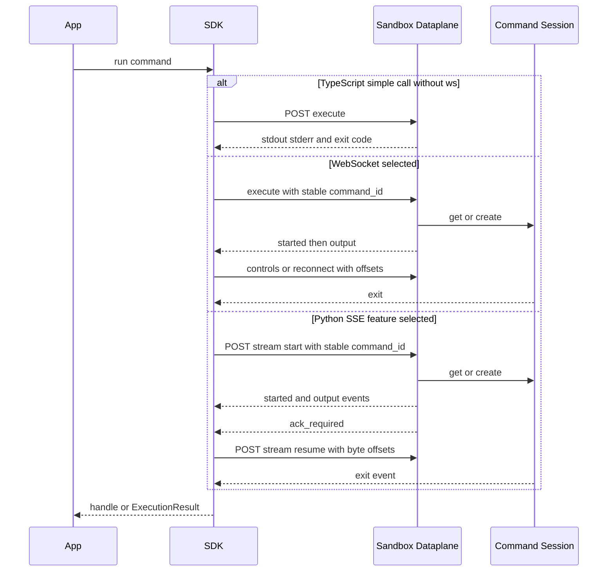

# Sandbox Lifecycle and Execution Transports

The sandbox APIs separate resource management from runtime traffic. TypeScript `SandboxClient` and Python `SandboxClient` / `AsyncSandboxClient` use the `/v2/sandboxes` control plane to create, inspect, update, start, stop, delete, and snapshot resources. A returned `Sandbox` or `AsyncSandbox` retains that metadata and uses its `dataplane_url` for commands and filesystem operations. Python additionally exposes service URLs and TCP tunnels.

Authentication and endpoint defaults follow the wider [client configuration model](/openwiki/concepts/client-configuration-and-auth.md). The sandbox base endpoint is derived from `LANGSMITH_ENDPOINT`, and `LANGSMITH_API_KEY` becomes `X-Api-Key`. Default headers reach control-plane HTTP, dataplane HTTP, and WebSocket upgrades; Python also accepts operation-level header overrides.

## Creation, readiness, and lifecycle

Creation posts to `/boxes`. It can boot the default runtime or a snapshot and configure name, CPU, memory, root-filesystem capacity, mounts, proxy policy, boot `run_config`, access delegation, and two retention clocks:

- `idle_ttl_seconds` / `idleTtlSeconds` stops an inactive sandbox. `0` disables idle stop.
- `delete_after_stop_seconds` / `deleteAfterStopSeconds` permanently removes a stopped sandbox and its filesystem clone after the interval. `0` disables stop-anchored deletion.

Both TTLs must use minute resolution; omission leaves the server default in force. Python accepts snapshot UUIDs, `name:tag`, and bare names through `snapshot`; the TypeScript overload distinguishes a snapshot ID from `snapshotName`.

Creation normally asks the server to wait. With `wait_for_ready=False` or `waitForReady: false`, it returns a provisioning object. `wait_for_sandbox()` / `waitForSandbox()` polls the lightweight `/status` endpoint, fetches the complete sandbox only after `ready`, maps `failed` to a resource-creation error, and puts the last observed status on a timeout error.

*Sandbox resource states observed and acted on by the SDK; snapshot building has a separate lifecycle.*

Runtime methods deliberately do **not** gate on the object's cached `status`. They require only `dataplane_url`: `stop()` preserves that stable URL and updates local status, and a later dataplane request may wake the runtime. An absent URL raises `DataplaneNotConfiguredError` / `LangSmithDataplaneNotConfiguredError`; actual readiness and connection failures are mapped from the server. Explicit `start()` posts to `/start`, waits for readiness, and refreshes local status and URL.

### Ownership and cleanup

- Python `client.sandbox()` returns an auto-deleting context-manager sandbox. `with` and `async with` suppress deletion failures so cleanup cannot mask an exception from the body. `create_sandbox()` is manually managed. Sync/async conversions refer to the same server resource but disable auto-delete on the converted object.
- TypeScript has no auto-deleting `Sandbox` context manager; use `try` / `finally` and `await sandbox.delete()`.
- Closing a Python client closes its HTTP pools, not manually managed sandboxes.
- Stop is reversible and preserves files. Delete is the terminal resource operation.

## Mounts, boot identity, and delegated access

Both SDKs build S3, GCS, credential-free public HTTPS Git, and read-only Context Hub mounts. Bucket mounts support read-only and cache settings. Context Hub synchronization is one-way; subsequent synchronization can overwrite guest writes unless configured as initial-pull-only.

Mount validation keeps provider credentials out of individual mount specs. GCS requires top-level GCP mount auth. S3 requires either top-level AWS mount auth or, where supported by the builder, an enabled AWS proxy rule; supplying the same provider in both mount and proxy auth is rejected. Auth blocks without a matching mount and duplicate provider blocks are also invalid.

Creation can attach `access_delegation`, allowing code inside the sandbox to call LangSmith without its own API key. `INHERIT` tracks the creator's current permissions and forbids a permission list; `EXPLICIT` requires a non-empty permission list. The grant is a ceiling rechecked against the creator on every request, not a snapshot of access. Because anyone able to execute in the sandbox can use the grant, it should be scoped as narrowly as possible.

## Files and downloadable links

`write()` sends strings as UTF-8 or accepts bytes and performs multipart upload to `/upload`. `read()` returns raw bytes from `/download`. Both SDKs also expose stat, byte-range reads, glob/listing, and literal grep dataplane operations; range callers must distinguish a `206` partial response from a `200` whole-file response after a validator mismatch.

`generate_download_url()` / `generateDownloadURL()` is a control-plane operation. It creates a bearer link bound to one sandbox and exact path, optionally with expiry and response headers. Possession is sufficient to fetch the file and a fetch can wake a stopped sandbox. The link is path-bound rather than content-snapshot-bound, so write changed content to a new path and mint a new URL.

## Service access and Python TCP tunnels

Service access is Python-only in the inspected APIs. Token mode (`sandbox.service()` or `client.service()`) mints a `ServiceURL`; its HTTP helpers inject `X-Langsmith-Sandbox-Service-Token`, and token-bearing fields refresh when within 30 seconds of expiry. The client-level `service(..., access="restricted" | "workspace")` instead creates a durable `ServiceLoginURL`: `restricted` requires `sandboxes:read`, while `workspace` admits members of the owning workspace. Login URLs have no token, expiry, or programmatic HTTP helpers. TypeScript does not expose these service helpers.

TCP tunneling is also Python-only. `Sandbox.tunnel()` and `AsyncSandbox.tunnel()` listen on loopback and connect to dataplane `/tunnel` over WebSocket. Each local TCP connection receives a yamux stream and is bridged to the requested guest port after the daemon's status response. A dead session is re-established under a lock with bounded backoff (`max_reconnects`, default `3`). `AsyncTunnel` delegates the same threaded implementation through an executor. This transport forwards arbitrary TCP; it is not a command-execution fallback.

## Choosing a command transport

The languages do not have transport parity:

| Path | TypeScript | Python | Controls and streaming |
|---|---|---|---|
| WebSocket `/execute/ws` | Preferred when optional `ws` is available | Default when optional `websockets` is available | Bidirectional output, stdin, close-stdin, signals, PTY, reconnect |
| Blocking HTTP `POST /execute` | Fallback only for `wait: true` without callbacks when `ws` is unavailable | Not selected by current `run()` | One terminal `ExecutionResult`; no handle |
| SSE `/execute/stream/start` and `/resume` | Not exposed | Experimental feature-gated alternative | One-way streaming and reconnect; no running-command controls or PTY |
| TCP `/tunnel` | Not exposed | Exposed | Arbitrary port forwarding, not command execution |

Python selects SSE first when `LANGSMITH_EXPERIMENTAL_FEATURES=sandbox_sse_exec`; otherwise it requires `websockets` and raises an installation/feature hint when no transport is available. The SSE feature is off by default and `nosandbox_sse_exec` explicitly disables it. TypeScript uses HTTP only for the simple blocking fallback; callbacks or `wait: false` require WebSocket. Python rejects callbacks with `wait=False`, whereas TypeScript permits callbacks on the returned non-blocking handle.

*Execution selection and the distinct request shapes for blocking HTTP, WebSocket, and Python SSE.*

## WebSocket commands and reconnects

A WebSocket start sends a client-generated `command_id` and waits for `started` with command ID and PID. Before that acknowledgement, transient connection failures or early closure cause the SDK to retry with the **same** ID, allowing the daemon's get-or-create behavior to avoid duplicate processes. Upgrade statuses `429`, `500`, `502`, `503`, and `504` are retryable; numeric `Retry-After` overrides jittered exponential backoff. Each open attempt is clamped by the whole-connect budget.

Frames then progress through interleaved `stdout` / `stderr` to `exit`; an `error` frame maps to a typed failure. Handles aggregate an `ExecutionResult`, expose iteration and process identity, and provide kill, stdin, close-stdin, and manual reconnect controls appropriate to the language's sync/async model.

After `started`, command lifetime is independent of the socket unless `kill_on_disconnect` is set. Reconnect carries command ID plus separate stdout and stderr **UTF-8 byte offsets**. Automatic reconnect allows five consecutive failures, reconnects immediately for server reload, and stops retrying after kill. Output resets the budget; for a quiet WebSocket command, a `started` acknowledgement resets it only when its command ID matches the attached command. Command timeout, missing or expired sessions, malformed frame order, and a stream ending without `exit` remain failures.

## Python SSE execution

SSE reuses `CommandHandle` / `AsyncCommandHandle` by translating HTTP events into the same internal `started`, output, and `exit` messages. Sync execution uses the client's synchronous `httpx` stream and async execution uses its asynchronous stream; both support blocking results, callbacks, `wait=False` handles, and explicit `reconnect()`.

`POST /execute/stream/start` includes a stable generated `command_id` plus command, shell, timeout, idle timeout, TTL, and optional environment, working directory, and `run_config`. If failure occurs before `started`, the start body is resent with the same ID. Thereafter `/execute/stream/resume` carries `command_id`, `stdout_offset`, and `stderr_offset`.

Output data is base64-decoded as bytes. Separate incremental decoders retain an incomplete UTF-8 character across chunk and resume boundaries, while cursors advance by raw byte count. `stream_end` flushes a trailing incomplete sequence as the replacement character; `exit` also flushes both streams and is the successful terminal event. `error` maps through the command error mapper, except `ServerShuttingDown`, which triggers resume. A resume `404` becomes `CommandNotFound` rather than restarting the command.

SSE has no mid-stream control channel. When the bounded server buffer needs acknowledgement, it terminates the response with `ack_required`; the SDK immediately posts `/resume` using the supplied offsets, which are both acknowledgement and next-read cursor. This protocol-driven resume does not consume retry budget. Broken/truncated responses and recoverable transport errors retry resume with jittered exponential backoff, at most five consecutive attempts; actual output resets that budget, but a `started` event alone does not. `LANGSMITH_SANDBOX_SSE_TIMEOUT_READ` controls the per-event timeout (default 60 seconds, non-positive disables it).

Because the transport is one-way, SSE rejects `pty=True`, `close_input=False`, and `kill_on_disconnect=True`; handles cannot send input or kill a running command. These are WebSocket capabilities, not SSE capabilities.

## Snapshots

Snapshots are reusable boot sources with a separate `building` to `ready` or `failed` resource lifecycle. Clients build from container images, capture running sandboxes, list/get/delete snapshots, and poll completion. Capturing a snapshot does not move the sandbox itself into a snapshot state.

Dockerfile helpers orchestrate a temporary builder sandbox: package and upload the local context, run BuildKit on the capacity-backed root filesystem, capture the resulting image, and delete the builder in a context manager or `finally`. Build failure maps to a snapshot-creation error without skipping builder cleanup.

## Failure boundaries and focused tests

Sandbox-specific hierarchies distinguish authentication/API/validation/quota failures, missing resources, creation and polling timeouts, absent dataplane configuration, not-ready runtimes, operation errors, command timeouts, and transport failures. HTTP handlers preserve structured server details and `error_id` values where available. Transport code adds protocol-specific mapping: WebSocket handshake classification, SSE resume `404`, command error events, and tunnel daemon status are handled at their respective boundaries.

High-value tests include:

- `sandbox_ws_handshake.test.ts` for retryable upgrade statuses, `Retry-After`, and permanent `4xx` failures.
- `sandbox_reconnect_ack.test.ts` for matching versus mismatched quiet-command acknowledgements.
- `test_sse_execute.py` for feature selection, request payloads, acknowledgements, retries, UTF-8 reconstruction, terminal events, errors, unsupported controls, and sync/async behavior.
- `test_sandbox_sse_exec.py` for live multi-megabyte exactly-once output across repeated acknowledgements.
- `test_service_access.py` for token versus LangSmith-login service URL modes.

These boundaries complement the [repository test strategy](/openwiki/testing/repository-test-strategy.md) and the broader [SDK architecture](/openwiki/architecture/sdk-architecture.md).
