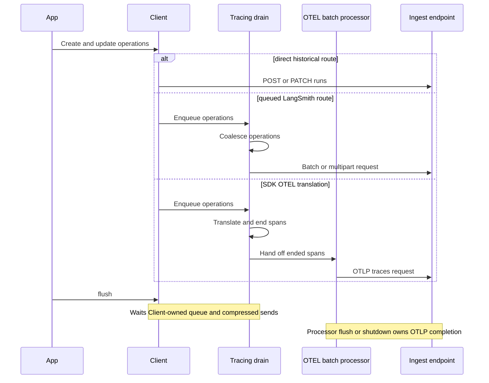

# Measured Trace Ingestion Paths

This page preserves a **historical trace-lab capture**. The capture ran a 60-run application that produced 120 operations—a post on enter and a patch on exit—against a fake LangSmith backend configured to answer each ingest request in 20 ms. **End to end** spans the first through last log record, while **App thread busy** spans rows on the application's own thread; the gap indicates work that moved off that thread.

> **Scope and interpretation:** these are observations from one instrumented capture, not current throughput targets, latency promises, or performance guarantees. Timings are rounded to 10 ms. The recorded call counts, multipart part counts, and wire byte counts are reproduced as committed; they have not been recomputed against the current SDK.

The capture's route named `/otel` used an explicitly configured complete lab URL ending in `/otel`, so `POST /otel` below is **historical lab behavior**. It is not the current default endpoint for Python SDK OTEL translation or the public native `OtelSpanProcessor`; both default to `POST /otel/v1/traces`. For the maintained implementation model—including endpoint resolution, queue and I/O thread ownership, retries, and flush/shutdown boundaries—see [Trace Capture, Transformation, and Ingestion](/openwiki/workflows/trace-capture-and-ingestion.md).

## Route comparison

| Path | HTTP calls | End to end | App thread busy | Bytes on the wire | `post.*` parts | `patch.*` parts |
|---|---|---|---|---|---|---|
| `/runs` | 120 | 3,500 ms | 3,500 ms (100%) | 109,180 | — | — |
| `/runs/batch` | 2 | 260 ms | 170 ms (67%) | 55,500 | — | — |
| `/runs/multipart` | 2 | 360 ms | 200 ms (54%) | 106,976 | 300 | — |
| `/runs/multipart+zstd` | 2 | 270 ms | 240 ms (89%) | 6,488 | 300 | 240 |
| lab `/otel` | 1 | 360 ms | 320 ms (89%) | 40,987 | — | — |
| lab `hybrid` | 3 | 460 ms | 430 ms (93%) | 147,963 | 300 | — |

The `post.*` and `patch.*` columns count multipart body parts, not runs or HTTP calls. The direct and JSON-batch paths do not use multipart parts. Values in this table belong to the historical fixture and workload; route selection, payload shape, network conditions, and backend behavior can all change real-world results.

## How to map the capture to the current implementation

The capture remains useful for understanding ownership boundaries even though its endpoint configuration was lab-specific:

- Direct `/runs` create/update work is synchronous on the application thread. Queued JSON and uncompressed multipart work is drained by the Client tracing control thread or a scaled drain subthread.
- Python zstd multipart uses a compressed frame and dispatches sends through `LANGSMITH_CLIENT_THREAD_POOL`; `Client.flush()` drains buffered run operations, waits unfinished tracing-queue tasks, closes buffered compressed data, and waits tracked send futures subject to its timeout.
- In `tracing_mode="otel"`, queued run operations are coalesced and translated to spans on a tracing drain thread. Ending a translated span transfers it to OpenTelemetry's processor; the default `BatchSpanProcessor` owns OTLP network I/O.
- In `tracing_mode="hybrid"`, compression is disabled. The same drained operation set feeds the LangSmith request and OTEL translation. The two transports have distinct completion boundaries.
- The public `OtelSpanProcessor` is a peer native-span route, not the route benchmarked here: it wraps an OpenTelemetry processor (a `BatchSpanProcessor` by default), bypasses `Client.tracing_queue`, and delegates `force_flush()` and `shutdown()` to that processor.

*Caption: The historical timing rows span different ownership boundaries; current Client flush and OTEL processor flush are separate completion operations.*

### Endpoint resolution today

For the internal Python provider, `OTEL_EXPORTER_OTLP_TRACES_ENDPOINT` wins and is treated as the complete traces URL. Otherwise `OTEL_EXPORTER_OTLP_ENDPOINT` is treated as a base and `/v1/traces` is appended. With neither set, the base is `{LANGSMITH_ENDPOINT}/otel`, producing `{LANGSMITH_ENDPOINT}/otel/v1/traces`. A temporary compatibility case preserves a base already ending in `/traces` and warns users to move the complete URL to `OTEL_EXPORTER_OTLP_TRACES_ENDPOINT`. `OTEL_EXPORTER_OTLP_HEADERS`, when present, replaces generated API-key and project headers.

The public `OtelExporter` also defaults to `{LANGSMITH_ENDPOINT}/otel/v1/traces`; its explicit `url` is already a complete endpoint. By contrast, `OtelSpanProcessor(url=...)` treats `url` as a base and appends `/otel/v1/traces`. Keep those constructor contracts distinct from the internal provider's standard OTLP environment precedence.

### Flush interpretation

The historical `[15c]` rows are intentional evidence of a boundary, not a current defect claim: the lab observed `Client.flush()` after Client queue translation while 60 spans were still open or processor-owned. Current `Client.flush(timeout)` governs the Client run-operation queue and compressed sends; it does not call a custom or public OTEL processor's flush. Use the owning provider or processor's `force_flush()` or `shutdown()` when OTLP delivery must be completed before process exit.

## Per-path storylines

### `/runs` -- 120 call(s): 60 × POST /runs, 60 × PATCH /runs/<id>

| At | Thread | Step | What happened |
|---|---|---|---|
| ~70 ms | — | `[14]` | 60 × app: POST /runs …B, 60 × app: PATCH /runs/step …B |
| ~3,500 ms | app | `[15]` | flush() |

### `/runs/batch` -- 2 call(s): 2 × POST /runs/batch

| At | Thread | Step | What happened |
|---|---|---|---|
| ~10 ms | tracing | `[00]` | no zstd frame (backend /info: no multipart) → queue to /runs/batch |
| ~150 ms | tracing | `[12]` | drained 100 queue items |
| ~150 ms | tracing | `[13]` | combine 100 ops → 50 |
| ~150 ms | tracing | `[14]` | POST /runs/batch 46240B |
| ~170 ms | app | `[15]` | flush() |
| ~240 ms | tracing | `[12]` | drained 20 queue items |
| ~240 ms | tracing | `[13]` | combine 20 ops → 10 |
| ~240 ms | tracing | `[14]` | POST /runs/batch 9260B |

### `/runs/multipart` -- 2 call(s): 2 × POST /runs/multipart

| At | Thread | Step | What happened |
|---|---|---|---|
| ~160 ms | tracing | `[12]` | drained 100 queue items |
| ~160 ms | tracing | `[13]` | combine 100 ops → 50 |
| ~180 ms | tracing | `[14]` | POST /runs/multipart 89118B |
| ~200 ms | app | `[15]` | flush() |
| ~340 ms | tracing | `[12]` | drained 20 queue items |
| ~340 ms | tracing | `[13]` | combine 20 ops → 10 |
| ~340 ms | tracing | `[14]` | POST /runs/multipart 17858B |

### `/runs/multipart+zstd` -- 2 call(s): 2 × POST /runs/multipart

| At | Thread | Step | What happened |
|---|---|---|---|
| ~10 ms | tracing | `[00]` | zstd frame BUILT (level 1, cap 1073741824B) |
| ~200 ms | compress | `[12]` | frame closed [data available, 100-op limit] 86630→4935B (17.6x) |
| ~200 ms | compress | `[12b]` | send frame: 4935B to 1 dest |
| ~200 ms | compress | `[14]` | POST /runs/multipart 4935B zstd |
| ~240 ms | app | `[15]` | flush() |
| ~240 ms | app | `[12]` | frame closed [flush(), forced, whatever is buffered] 17330→1553B (11.2x) |
| ~240 ms | compress | `[12b]` | send frame: 1553B to 1 dest |
| ~240 ms | app | `[15b]` | flush waits on 2 in-flight send(s) |
| ~240 ms | compress | `[14]` | POST /runs/multipart 1553B zstd |

### Lab `/otel` -- 1 call(s): 1 × POST /otel

| At | Thread | Step | What happened |
|---|---|---|---|
| ~0 ms | app | `[21c]` | OTLP target: POST /otel |
| ~0 ms | app | `[21]` | OTEL path BUILT (built its own provider) |
| ~10 ms | tracing | `[00]` | no zstd frame (tracing_mode=otel) → queue to /runs/multipart |
| ~200 ms | tracing | `[13]` | combine 100 ops → 50 |
| ~200 ms | tracing | `[23]` | otel leg: 50 run op(s), 0 dropped |
| ~200 ms | tracing | `[24]` | export_batch: 50 post, 0 patch (0 open) |
| ~220 ms | — | `[26]` | 60 × otel: OTLP export: step (13 attrs) |
| ~260 ms | app | `[15]` | flush() |
| ~310 ms | tracing | `[13]` | combine 20 ops → 10 |
| ~310 ms | tracing | `[23]` | otel leg: 10 run op(s), 0 dropped |
| ~310 ms | tracing | `[24]` | export_batch: 10 post, 0 patch (50 open) |
| ~320 ms | app | `[15c]` | flush() does not cover OTEL (60 span(s) open) |

### Lab `hybrid` -- 3 call(s): 2 × POST /runs/multipart, 1 × POST /otel

| At | Thread | Step | What happened |
|---|---|---|---|
| ~0 ms | app | `[21c]` | OTLP target: POST /otel |
| ~0 ms | app | `[21]` | OTEL path BUILT (built its own provider) |
| ~10 ms | tracing | `[00]` | no zstd frame (tracing_mode=hybrid) → queue to /runs/multipart |
| ~180 ms | tracing | `[13]` | combine 100 ops → 50 |
| ~180 ms | tracing | `[23c]` | hybrid: 50 op(s) both ways, one thread |
| ~180 ms | tracing | `[12]` | drained 100 queue items |
| ~200 ms | tracing | `[14]` | POST /runs/multipart 89118B |
| ~220 ms | app | `[15]` | flush() |
| ~300 ms | tracing | `[23]` | otel leg: 50 run op(s), 0 dropped |
| ~300 ms | tracing | `[24]` | export_batch: 50 post, 0 patch (0 open) |
| ~330 ms | — | `[26]` | 60 × otel: OTLP export: step (13 attrs) |
| ~370 ms | tracing | `[13]` | combine 20 ops → 10 |
| ~370 ms | tracing | `[23c]` | hybrid: 10 op(s) both ways, one thread |
| ~370 ms | tracing | `[12]` | drained 20 queue items |
| ~380 ms | tracing | `[14]` | POST /runs/multipart 17858B |
| ~420 ms | tracing | `[23]` | otel leg: 10 run op(s), 0 dropped |
| ~420 ms | tracing | `[24]` | export_batch: 10 post, 0 patch (50 open) |
| ~430 ms | app | `[15c]` | flush() does not cover OTEL (60 span(s) open) |

## Provenance

The capture was generated on the `learn/trace-ingest-logs` branch by `python/trace_lab/build_timeline.py --app bulk --md`. This wiki page is the durable copy of the committed capture.

## Related pages

- [Trace Capture, Transformation, and Ingestion](/openwiki/workflows/trace-capture-and-ingestion.md)
- [Run Tree and Context](/openwiki/concepts/run-tree-and-context.md)
- [Repository Test Strategy](/openwiki/testing/repository-test-strategy.md)
